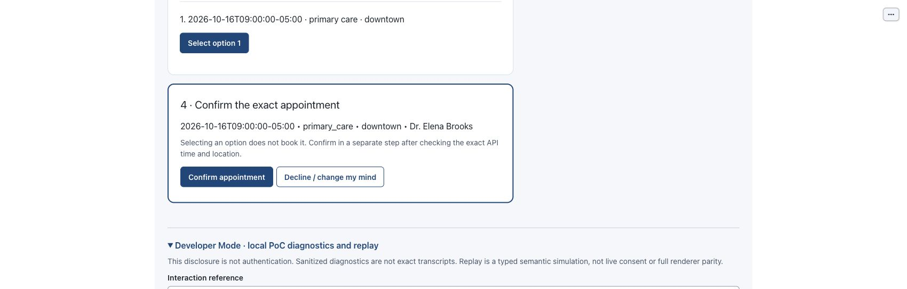

# BOB · synthetic scheduling PoC

Canonical repository: [Kenerator/ochsner-scheduling-bob](https://github.com/Kenerator/ochsner-scheduling-bob).

Internal-use Ochsner proof of concept, with publicly accessible source and approved
branded synthetic assets; not a public application deployment. One guarded scheduling core serves a deterministic
CLI and paired Marimo patient/support views. Uses the unchanged supplied HTTP mock,
standalone ZEN policy, public-only RapidFuzz suggestions, and optional bounded
OpenAI interpretation. No PHI, clinical advice, production authentication, real
staff contact, sponsor endorsement or general third-party relicensing is implied.

## What you can try

- Find providers, refine location/dates/provider filters, look up the current
  synthetic patient's appointments, and review an exact proposal before a
  separate confirmation. Correct or decline without canceling prior bookings.
- Pair a local Support view with the patient's acknowledged public screen;
  demonstrate takeover/return and explicitly accepted public suggestions.
- Inspect sanitized state, rule/API/model diagnostics with recording OFF. Open
  an owned OFF reference for current sanitized inspection, not an exact history.
  Opt in separately for synthetic recording, recorded-only replay and variants.
- Use the same guarded behavior through an offline CLI; optional language
  interpretation proposes public intent/preferences, never identity or consent.

| Repository/runtime boundary | Responsibility |
| --- | --- |
| `apps/`, `widget.py`, `widget.js` | Marimo/AnyWidget patient and Support presentation |
| `conversation.py` → `session.py` | Shared commands, identity, proposal and effect authority |
| `http_mock.py` → `vendor/reference/` | Validated synthetic reads/writes against the unchanged supplied mock |
| `policy.py`, `policies/bob.json`, `suggestions.py`, `language.py` | ZEN policy, public suggestions, optional bounded interpretation |
| `journal.py`, `diagnostics.py`, `interaction_service.py`, `replay.py` | Durable effect protection, sanitized inspection, isolated replay |

See the existing [component/authority diagram](docs/internal/as-built/architecture.md#components-and-authority)
and [code walkthrough](docs/internal/as-built/code-walkthrough.md).



Historical offline Chrome viewport: returned appointment **before** separate
Confirm, source `4a21cafb803dac5a50c8f03dac83c923698435fa` with a disclosed
disposable backend-port change. Not current-source browser qualification;
[original capture details](assets/ui/stills/quickstart-20261009/manifest.json).

## Start here

Required qualification target: macOS ARM, **Python 3.11+**. Verify your executable;
the host's system `python3` may be 3.9. Do not replace global Python.

```sh
git clone https://github.com/Kenerator/ochsner-scheduling-bob.git
cd ochsner-scheduling-bob

python3.11 --version
python3.11 -m venv .venv
.venv/bin/python -m pip install -e .
.venv/bin/python -m pip check
node --version
PYTHONPATH=src .venv/bin/python -m unittest discover -s tests -v
.venv/bin/python scripts/demo_booking.py --flow all
```

Use any explicitly verified compatible executable instead of `python3.11`.
Run subsequent commands from this repository root. JavaScript boundary tests
require **Node.js 22.14.0** (qualified locally; also selected by offline CI).
The widget has explicit ESM classification, including when syntax detection is
disabled. Node is a verification prerequisite, not an application runtime
dependency; no npm install is needed. Direct dependencies are pinned in [pyproject.toml](pyproject.toml);
transitive dependencies are not a reproducible lock. No API key is needed offline.

In two terminals from this root:

```sh
# Terminal 1: owns and stops its own supplied mock child
mkdir -p -m 700 .bob-local
.venv/bin/python scripts/serve_browser.py --port 28451 --ui-port 28450
# Terminal 2: local presentation only
.venv/bin/marimo run apps/scheduling_app.py --host 127.0.0.1 --port 28450 --session-ttl 3600 --headless
```

Open `http://127.0.0.1:28450/`. The shipped widget expects backend **28451**, and
the sidecar permits UI origin **28450**. Keep that fixed pair together; launcher
port flags alone do not reconfigure the widget. Do not stop another process to
free a port. The sidecar owns a separate mock on an OS-selected loopback port.

Click **Start independent patient**, choose Primary
care / Downtown and Find providers. Choose provider 1. Enter the supplied synthetic
fixture in private controls: phone `555-0101`, DOB `1985-04-12`, ZIP `70112`.
Get availability, select a returned option, review its exact API time/location/provider,
then Confirm in a separate step. Selection does not book. Phone format is exact.

Create a one-use support grant and join it from a separate tab. Support sees the
last acknowledged public screen, not private drafts or confirmation authority.
Takeover/return and preference suggestions are local demonstrations; a suggestion
requires patient acceptance after return. Lower Developer Mode exposes bounded
sanitized diagnostics and **recorded-only shared-core replay**. Complete matching
captures qualify semantic core projections, not full browser-renderer parity.
“Joined” describes the paired role; “active/inactive” describes its separate
control lease. Ending control does not unpair the local participant.

Ctrl-C each owned terminal to stop it. Workflow Reset never clears uncertain-effect
protection. A fresh mock run uses a new explicit `--namespace .bob-local/run-N`;
retain old files for reconciliation. Never delete/reset the shared model budget.
Restarting Marimo alone does not restart the backend or perform a write.
The `mkdir` prerequisite above is required before a nested `run-N` namespace;
the launcher creates its immediate run directory, not missing ancestor directories.
Continue with the [task-oriented guide](docs/user/getting-started.md) for lookup,
refinement, correction, decline and recovery.

## CLI and optional language

Start `.venv/bin/python scripts/mock_lifecycle.py --port 4010`, then in another
terminal run `.venv/bin/python -m ochsner_bob`. Type `help` for deterministic commands.
Identity uses `/identity 555-0101 1985-04-12 70112`; exact confirmation uses `/confirm`.
Use `/diagnostics` for sanitized inspection without changing the workflow.
The browser and CLI use the same Conversation/Session behavior, not the inherited
`poc-demo` sketch.

OpenAI is explicitly opt-in: add `--openai` to the browser launcher or CLI, with
`BOB_ENABLE_OPENAI=1`, `BOB_OPENAI_MODEL`, and securely configured `OPENAI_API_KEY`
in that process environment. Never put a key in arguments, source, browser or logs.
One private root ledger limits all qualification/CLI/browser calls to **200 / $20**;
uncertain usage retains its reservation. No tools, automatic retries or silent
model fallback. View/poll/replay never invokes a model. See
[qualification and actual cost uncertainty](docs/internal/live-qualification.md).

## Verification and historical checkpoints

The [BOB profile](docs/internal/qualification.json) runs dependency checks,
combined regressions, all eight supplied-HTTP scenarios, success/conflict/unknown
booking demos and shipped-widget JavaScript boundaries. The
[offline workflow](.github/workflows/bob-offline.yml) executes that committed
profile on a standard Ubuntu runner with read-only permissions and SHA-pinned
official actions. Actual run evidence belongs in the native ledger; CI is not
Mac ARM, browser, genuine-model or production qualification, and no new required
branch-protection context is implied.

Immutable **RC-1** (`e2dfa7e9f471513921063d568bb3bc890eff1800`) records the
historical 398-test source and clean Mac export. **RC-2**
(`c8463252251dd840ac443641702656fd3134eebc`) records the 415-test completeness
repair, normally merged through [PR #3](https://github.com/Kenerator/ochsner-scheduling-bob/pull/3)
at `96b9bb8`. Later [limited IAB evidence](docs/internal/video-notes.md#completeness-iab-supplement--2026-10-10)
retains acknowledgement/reconnect warnings and renderer parity false. Historical
captures/counts keep their source bindings; see the [native evidence ledger](specs/001-ochsner-scheduling-assistant/tasks.md)
and [milestones](docs/internal/milestones.md). No root application license is selected.

## Document index

- Native authority: [spec](specs/001-ochsner-scheduling-assistant/spec.md), [plan](specs/001-ochsner-scheduling-assistant/plan.md), [task/evidence ledger](specs/001-ochsner-scheduling-assistant/tasks.md), [quickstart](specs/001-ochsner-scheduling-assistant/quickstart.md).
- Product: [personas](docs/product/personas.md), [stories](docs/product/user-stories.md), [decisions](docs/product/decisions.md), [backlog](docs/product/backlog.md), [roadmap](docs/product/roadmap.md), [increments](docs/product/sprint-planning.md), [next steps](docs/product/next-steps.md).
- Review: [demo](docs/internal/demo.md), [video/stills](docs/internal/video-notes.md), [persona/test crosswalk](docs/internal/persona-story-test-index.md), [performance](docs/internal/performance-notes.md), [Marimo feasibility](docs/internal/marimo-feasibility.md).
- User help: [patient, Support and Developer guide](docs/user/getting-started.md), [recovery and irreversible purge](docs/user/recovery.md).
- As built: [walkthrough](docs/internal/as-built/code-walkthrough.md), [architecture](docs/internal/as-built/architecture.md), [UI provenance](docs/internal/ui-assets.md), [mock provenance](vendor/reference/PROVENANCE.md).
- Delivery: [credential guard](docs/internal/security.md), [milestones](docs/internal/milestones.md), [independent review](docs/internal/reviews/adversarial-review.md).
- Future design only: [cost/monitoring, rollout/rollback and authenticated support](docs/product/production-design-notes.md); [actual adopted ZEN model](policies/README.md#adopted-policy-index).

Inherited `poc_template`/`poc_demo` modules remain scaffold support/history, not BOB
authority or evidence. Detailed completion and open limitations live only in the
native task ledger. Synthetic tests and a small genuine-language sample do not
establish accessibility conformance, model reliability, real-service safety or production readiness.
