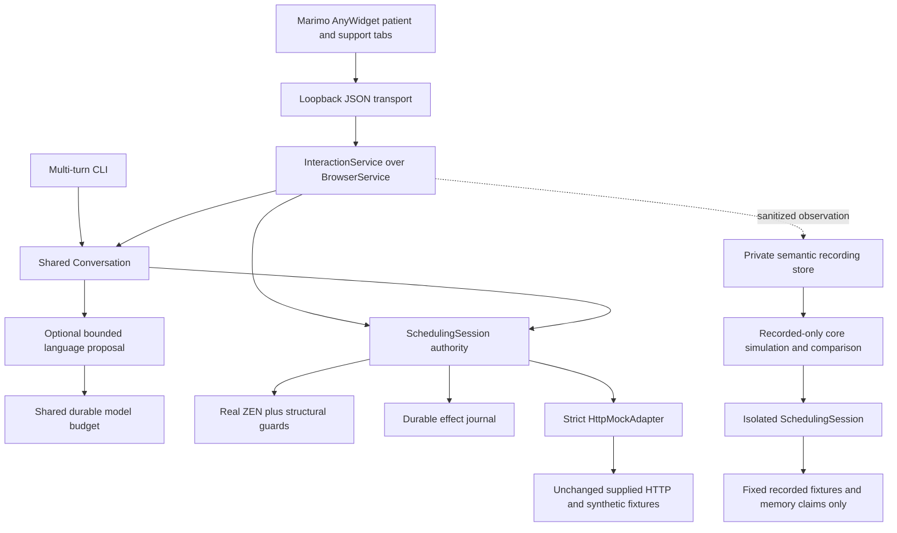
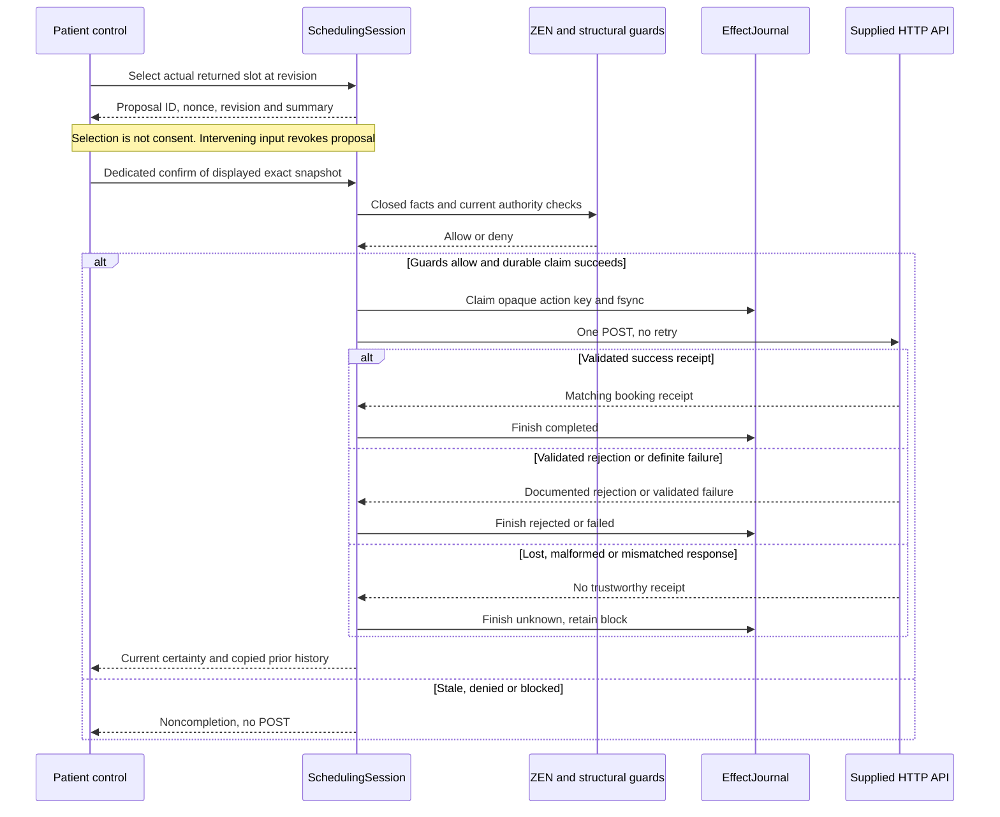

# As-built architecture

## Completeness delta — 2026-10-10

Repair base `00ed37d`; final reviewed source will be recorded in native T056.
[Diagnostics](../../../src/ochsner_bob/diagnostics.py) observes validated API
outcomes (not a bare HTTP 201) and public model context/disposition/timing through
actual CLI/InteractionService constructors, independently of exact recording.
Per-session bounded memory and categorical drop counts keep raw identity,
inputs/output, receipts and exceptions out of diagnostics. CLI `/diagnostics`
and browser inspection are effect-free.

[Recording/Replay](../../../src/ochsner_bob/replay.py) now retain bounded ordered
browser receipts bound to delivered core-step revisions. Presentation includes
notice/loading/dirty/confirmation-enabled observations; drafts/focus/disclosures
remain public-only. They are original observations, never variant predictions
or confirmation authority. Required missing/legacy partial receipts make capture
incomplete while core parity is reported independently. Strict import, TTL,
aggregate limits and isolated core effects remain in force, including required
receipt markers. Ordering/clock variants drop original receipts rather than
transplanting them to different commands or simulation clocks. Imported drafts
also pass the live privacy/opaque-ID gate. Capture completeness is an internal
schema/evidence assessment, not authenticity: a re-signed imported document is
still untrusted history, and its digest confers no authority or browser proof.
Model metadata publishes under the service freshness lock; delayed older
revisions cannot replace newer diagnostics. Write 404 is failure, not rejection;
400/409 remain rejection and lost/malformed receipts remain unknown.
Tests: [receipt contracts](../../../tests/test_view_receipt_capture.py),
[recording-OFF constructors](../../../tests/test_live_diagnostics.py).
Topology/authority diagrams below are unchanged; their source/count paragraphs
remain historical RC-1 evidence, not new qualification.

Historical checkpoint reviewed 2026-10-10: code/test source `e2dfa7e9f471513921063d568bb3bc890eff1800` (RC-1).
Documentation finalized after that tested source checkpoint. [Walkthrough](code-walkthrough.md),
[spec](../../../specs/001-ochsner-scheduling-assistant/spec.md),
[plan](../../../specs/001-ochsner-scheduling-assistant/plan.md),
[native task ledger](../../../specs/001-ochsner-scheduling-assistant/tasks.md),
[decisions](../../product/decisions.md). This describes actual source, not deployment readiness.

## Components and authority

The 2026-10-10 repair retains this topology and all live effect/privacy boundaries.
[Post-booking replay tests](../../../tests/test_post_booking_replay.py) cover
validated dynamic appointment rows: capture binds each complete row to the current
approved synthetic identity and a unique approved public slot, rather than
persisting private rows or requiring a static appointment ID. Replay constructs
simulation-only placeholder receipts through its recorded-only port; invalid,
ambiguous or foreign rows remain incomplete. This is not live receipt replay.

[Support status tests](../../../tests/test_support_status.py) separate BrowserService's
resolved paired role (`joined`) from SchedulingSession's control lease
(`active`/`inactive`). The session alone reports membership unknown; it cannot
infer a browser binding. Lease expiry/Return ends control, not pairing. Widget
status remains visible before the first acknowledged patient screen. No private
identity, selection or confirmation authority is added. Parent and clean committed
export both passed 398 tests and all three demos; actual browser evidence and
renderer-parity limits are [separately source-bound](../video-notes.md#feature-completion-supplement--2026-10-10).



Arrows are calls/data flow, not permission delegation. Only SchedulingSession
crosses booking/handoff effect boundaries. Model proposals, ZEN allow, support
acknowledgement and replay cannot replace local identity/fresh exact confirmation.
Replay has no effect path. Capabilities are local demo access, not production
patient authentication. CLI/browser share Conversation; explicit browser controls
submit the same core commands. Sidecar authority lives outside Marimo kernels.
The [owned launcher](../../../scripts/serve_browser.py) does not clean unrelated
processes. [Vendored provenance](../../../vendor/reference/PROVENANCE.md) records
the unchanged supplied server/four fixture files, not a replacement backend.

## Consent and write certainty



HTTP permits numeric loopback HTTP/explicit port only, no proxy/redirect/retry,
bounded timeout/body and strict schema. Booking compares submitted patient,
provider, specialty, location and offset-aware startTime. Validated 400/409 are
rejection and validated 503 is definite failure; malformed 503 cannot prove
nonexecution. ApiError is sanitized; possibly submitted writes with lost/malformed/
mismatched receipts are UnknownOutcome. API events contain categorical method,
normalized route, status and latency only.

Journal protection is **local duplicate protection, not remote idempotency or
exactly-once delivery**. Persisted attempted becomes unknown on new journal
instances. Unknown survives reset/restart when the same effect namespace is used;
missing/corrupt/unsafe storage denies. Rejection requires fresh options/summary
before another confirmation. Handoff means mock queued, not real staff delivery.

## State, privacy and persistence

| State | Owner/lifetime | Boundary |
| --- | --- | --- |
| Identity, filters, returned options, proposal, receipts | SchedulingSession memory | Corrections revoke private state first; failed reads clear stale private rows. Latest attempted result is separate from prior copied receipts. Full identity/history is not restart-persisted. |
| Effect claims | Private EffectJournal file/lock/marker | Stable flock/thread lock, fsync/atomic replace; opaque keys only. Reset cannot clear uncertainty. |
| CLI effect namespace | Private adjacent `.cli-namespace.json` plus stable lock/marker | Same journal resumes opaque session ID only; lifetime exclusive lock, atomic 0600 persistence, per-turn binding checks and foreign-claim rejection. No legacy migration or identity/consent restoration. |
| Capability bindings | BrowserService private adjacent registry | Digests bind role/session/issuance; bounded count, 24-hour expiry. Restart restores effect namespace, not identity/consent. One-use five-minute pairing grants are memory-only. |
| Public draft/disclosure and bearer capability | Widget per-tab sessionStorage | Private identity drafts not stored/mirrored; capability never enters URLs/trace references. Not production authentication. |
| Last patient observation | BrowserService memory | Exact delivered response plus accepted semantic receipt; support nonce stripped, current server context separately labeled. |
| Takeover/suggestion | BrowserService/session memory | Fresh acknowledgement, five-minute lease; no support identity/select/confirm. Explicit patient preference adoption after return. |
| Captures/forks | Private RecordingStore envelopes | Typed synthetic projection, quota/TTL/tombstones/purge; separate from effects/budget. |
| Model accounting | One project `.bob-local/model-budget.json` | Durable private reservation before dispatch; missing/corrupt/unsafe state denies. No prompts, credentials or raw responses. |

ZEN hashes the exact loaded graph and uses five closed categorical facts;
engine/schema failure denies, allow never overrides structural guards. RapidFuzz
only suggests fixed public vocabularies/current returned public providers, never
patients or automatic selection. See [walkthrough boundary tests](code-walkthrough.md#boundary-modules).

## Browser observation and concurrency

Acknowledgement contains bounded revision/renderer/visible/public-draft/focus/
scroll/disclosure fields and must refer to an actually delivered response.
Optional strictly typed `presentation: {notice, pending, dirty, can_confirm}`
additionally mirrors categorical warning/pending/unsent-edit status and the
observed confirmation-enabled state, never arbitrary notice text or consent.
Legacy three-field presentation receipts remain accepted. This does not convert
semantic observation into pixel parity.
Support's read-only patient renderer uses `observed_patient`, with age/staleness,
not current server state mislabeled as seen. Both support projections strip the
confirmation nonce. Semantic receipts are not pixel parity or proof of human understanding.

InteractionService waits for language outside its global lock, binds results to
turn/revision and permits polling, other sessions and local safety controls.
Delivered views include final categorical notices. Widget safety buttons remain
usable during pending text; dirty edits disable exact-snapshot confirmation.
Poll/read/ack cannot schedule or invoke models, but reads may expire takeover
(revocation-only). Host/Origin and closed JSON schemas are checked. The shipped
widget sidecar URL is fixed at port 28451 (default UI origin 28450); launcher port
changes alone do not reconfigure it.

## Replay fidelity and retention

Capture observes actual session/API/language boundaries, replaces private values
with approved host fixture references and records categorical certainty. Late
capture, unrepresentable commands/fields, ambiguous fixture bindings, missed
outcomes and overflow report explicit gaps, not invented history. Provenance
binds revision, working source, policy, prompt, schema, fixtures and pinned project
metadata; hashes confer no trust and metadata is not a resolved dependency lock.

Source provenance uses Git HEAD only when Git resolves exactly to this project
root. Git-free archives use the fixed bounded regular
[archive revision artifact](../../../.git_archival.txt), substituted by the
additive `.gitattributes` export rule. Unexpanded/malformed metadata, symlinks,
hardlinks and broken own checkouts fail closed; an ancestor repository is not
this source. Archive working-tree state is explicitly unknown (conservatively
dirty for legacy boolean consumers), while actual bytes are independently hashed.
This is identifier/drift evidence, not a signature, clean-byte proof or wheel
qualification. [Provenance regressions](../../../tests/test_source_provenance.py)
exercise actual archive substitution and offline capture/replay without Git.

Replay now runs the actual `SchedulingSession` using a fixed recorded-only port
and private in-memory effect claims. The normal production constructor still
uses the durable EffectJournal. Every replay gets a fresh opaque namespace;
recorded fixture references resolve only against the approved host catalog.
Fresh simulation proposals supply only simulation-local confirmation values,
never imported IDs/nonces. The original's sanitized core projection is compared
after every command: missing evidence, fixture gaps, source drift or mismatches
prevent a `core_semantic_parity=true` claim. Legacy typed-interpreter recordings
remain inspection-only/incomplete, not silently upgraded.

Fidelity is `representation: scheduling_core_v1`, with independent
`core_semantic_parity` and `core_renderer_parity=false` flags. Matching complete
captures reproduce categorical core state, revisions, preferences, option counts,
proposal presence, policy decisions and outcome/uncertainty history. They do not
reproduce private records/receipt identifiers, browser drafts/focus or full
acknowledgement history. The replay panel is not the complete browser renderer.
Compound language commands retain their recorded cause; changing the model category
does not apply old model-generated commands. Variants recompute actual core guards
but unchanged recorded API outcomes are explicitly counterfactual stubs, not
historical parity or a newly qualified API/model experiment.

Step/back/jump/play/tick/bookmark/fork/compare/regression proposals cannot reach
HTTP/models/journal. Typed forks preserve immutable lineage and recompute
prerequisites without supplying live authority. References are locators, not
capabilities; service access grants are memory-only/session-scoped. Restart keeps
private files, not automatic grants. Reviewed exports remain untrusted input.

Defaults: imports 1 MiB, 2,000 events, depth 12, strings 4,096 characters; each
recording 10 MiB, aggregate 100 MiB, TTL 24 hours. Oversize exports report inability
to reimport, not truncation. Strict imports reject private/authority/unknown fields,
duplicate keys, nonfinite values and executable/endpoint configuration. Replay/store
access checks expiry; store operations sweep expiry and explicit expire/purge
APIs exist. Tombstones retain
expiry status without payload; purge does not erase journals/budgets/unrelated
files. Importing an external export cannot revive the same purged/tombstoned
reference. Quota failure does not silently evict active captures. Evidence:
[replay](../../../tests/test_replay_contract.py), [store](../../../tests/test_recording_store.py),
[capture integration](../../../tests/test_interaction_service.py).
The [same-core regressions](../../../tests/test_replay_live_core.py) additionally
disable socket access, disk-journal construction and the legacy interpreter while
replaying actual supplied-HTTP capture; live state, write count and journal bytes
remain unchanged. They cover success/rejection/failure/unknown, identity ambiguity,
invalid correction, stale confirmation, takeover and typed variants.
The integrated `InteractionService.maintain_retention()` hook sweeps expired idle
replays, active captures and stored payloads, including restored stores, without
creating an unused recording store. Corrupt storage is preserved/reported while
expired memory is purged first. A host must schedule this hook to guarantee idle
cleanup without traffic. The integrated launcher now assigns it to the server's
`service_actions`, invoked by the serve-forever poll loop even without patient
requests; no separate detached daemon or external scheduler is introduced.

## Optional language

Offline deterministic interpretation is default. Explicit CLI/browser `--openai`
constructs LanguageAdapter plus the canonical project ModelBudget; construction/
view does not dispatch or reserve. Runtime `BOB_ENABLE_OPENAI`, `BOB_OPENAI_MODEL`,
`OPENAI_API_KEY` gates still apply. Safety/privacy routing precedes model input;
only public text/preferences/workflow is supplied. Closed structured proposals
cannot supply identity/slot authority/consent. Bounded direct HTTPS, no tools,
redirects or retries; failures are explicit, not silent offline fallback.

The ledger permits at most 200 calls/$20 per shared namespace, reserves worst-case
priced context plus bounded output before dispatch and settles validated numeric
usage only. Unknown billing/crashes retain reservations; calls never refund.
Another path cannot enforce the shared grant or legitimately replenish it. No
account-wide invoice reconciliation is claimed. [Genuine language qualification](../live-qualification.md)
separately reports the explicitly selected alternative's 12/12 semantic cases and
retains the default mini model's 10/12 result. This is not whole-product/browser/
booking qualification; this documentation worker performed no live calls.

## Reviewed source and verification

Historical reviewed code/test source `5e7ae0c6b1ae29d198f734a0c26e2c96e525b961`, 2026-10-09.
The following digests/results remain bound to that earlier milestone, not RC-1;
current repair evidence is linked above and in the native task ledger.
Clean committed-export qualification passed. Digests identify inspected bytes,
not production approval or a dependency lock:

| Snapshot | SHA-256 | Scope |
| --- | --- | --- |
| Integration code manifest | `b555b5b6cf8439377f07d1b1892eb2f4f2dae83214cf6e34dd0876c17654e554` | Sorted path/SHA-256 lines: `.py/.js/.mjs/.json` under src/ochsner_bob, apps, scripts, policies; includes sketches/probes, excludes docs/assets/vendor/dependency metadata. |
| Test code manifest | `d700c79e03e65b0ff788e8ca840952b46b203411115c5017c343e605273935e3` | Same method: `.py/.mjs` under tests; excludes JSON/YAML fixture bytes. |
| Native capture source | `118327af911fccf9cadb6a94c80432f830b70b15fb80a289341b5783b06f4aca` | build_provenance `_SOURCE` order: session, conversation, browser_service, interaction_service, replay, recording_store, journal, policy, language, http_mock `.py`; excludes CLI namespace/budget/widget/launchers. |

Reproduce broader manifests from the repository root; filename lines and their
final newlines are part of the hash:

```sh
rg --files src/ochsner_bob apps scripts policies -g '*.py' -g '*.js' -g '*.mjs' -g '*.json' | LC_ALL=C sort | xargs shasum -a 256 | shasum -a 256
rg --files tests -g '*.py' -g '*.mjs' | LC_ALL=C sort | xargs shasum -a 256 | shasum -a 256
```

Native capture instead hashes fixed-order NUL-separated filename + NUL + bytes
entries. Its fixture digest also reflects locally materialized relative-date
slots. Future source changes require a refreshed dated snapshot.

Fresh review evidence, 2026-10-09:

- Explicit `/Users/ken/codeRepos/ochsner-scheduling-bob/.venv/bin/python`, Python
  3.11.13; `PYTHONDONTWRITEBYTECODE=1 PYTHONPATH=src` and
  `-m unittest discover -s tests -v`: **387 tests passed, 21.155 seconds**, including same-core replay, archive
  provenance and explicit unknown legacy-observation labels.
  Historical/unit fixtures are included; not every test is acceptance evidence.
- `scripts/demo_booking.py --flow all` passed using that interpreter: supplied
  success completed, supplied conflict rejected then freshly completed, and the
  explicitly labeled accepted-write/hidden-receipt adapter fault stayed unknown
  with retry blocked. Unknown is not a supplied scenario.
- **75 local Markdown links/anchors** passed the earlier bounded validation;
  a later clean-export navigation audit is tracked separately in the task ledger.
  Parent subsequently rendered both actual Mermaid blocks through local Marimo
  in Chrome. A sequence-note semicolon caused a real parser failure, was replaced
  with a period, and both diagrams then rendered without parse errors. Visual
  inspection confirmed readable component labels, consent/claim ordering and
  completed/rejected/failed/unknown branches. Large diagrams require scrolling;
  this is not mobile or assistive-technology qualification.
- [Widget tests](../../../tests/test_widget_projection.py) use the shipped JS
  with a [minimal DOM/fetch harness](../../../tests/widget_harness.mjs), not actual
  browser/accessibility qualification. The genuine [early Marimo probe](../marimo-feasibility.md)
  predates the full UI and retains a server-replacement reconnect caveat; final
  paired renderer/reconnect fidelity is not inferred from it or replay.
- Subsequent parent report, 2026-10-09: the actual final UI passed capture → Help
  → discover → seal → open → step. This worker did not rerun that browser journey.
  It is scoped actual-UI evidence for those controls, not proof of full paired
  renderer/reconnect/accessibility qualification or semantic replay/core parity.
- Separately [recorded local HTTP performance](../performance-notes.md): parent
  measured 30 sequential requests on Darwin arm64/Python 3.11.13, p50 0.931 ms,
  p95 2.163 ms, max 2.358 ms, no model calls/effects. The real transport/shared
  Conversation/Session sample alternates public supplied-HTTP discovery and local
  Help; it measures decoded HTTP completion, not browser paint, internet latency,
  concurrency/capacity or model response time. This worker inspected the
  [measurement path](../../../scripts/measure_local.py), not a new benchmark run.

CLI restart regression was reproduced before its fix: initial 17 tests had 14
failures, including booking/handoff each dispatching a second write on same-journal
main reentry; an additional foreign-namespace-binding test was also observed red.
All 18 [restart tests](../../../tests/test_cli_restart.py) now pass through actual
main with an explicitly labeled unknown-write unit port. They cover unchanged
write count, Help/reset, no identity/consent restoration, thread/process exclusion,
lost/corrupt/unsafe state and legacy rejection. Existing legacy journals are
blocked, not silently migrated; preserve their files for explicit reconciliation.
Same `--journal` resumes protection. A genuinely new synthetic mock run uses an
explicit new `--journal` path, not deletion/reset of the old protected namespace.
These are launcher tests, not supplied-service or remote-idempotency evidence.
Native tasks/integration review own other remaining work.
No live human delivery, production authentication, browser-renderer replay parity
or deployment readiness is claimed.

Final clean-source qualification on `5e7ae0c6b1ae29d198f734a0c26e2c96e525b961`: fresh Python 3.11.13
arm64 venv/editable install, 387 tests (19.282 s), 9 supplied-HTTP checks including
all eight exact scenarios, success/conflict/unknown demos and 6 widget boundary
checks passed. Profile SHA-256 `360b20ef914961240f58812111a0bbcdb1fa835ff48425a1986ab640164b2e1f`.
This native helper does not claim browser/live-model/remote-clone coverage; actual
manual browser and genuine-language evidence retain their separate source limits.
The earlier export failure at 9625185 is retained in the native task ledger.

Refreshed source-bound performance at this revision: 30 sequential loopback
requests, p50 1.202 ms, p95 2.807 ms, max 2.849 ms, zero effects/model calls.
It is decoded HTTP completion, not browser paint or a capacity/SLA guarantee.
