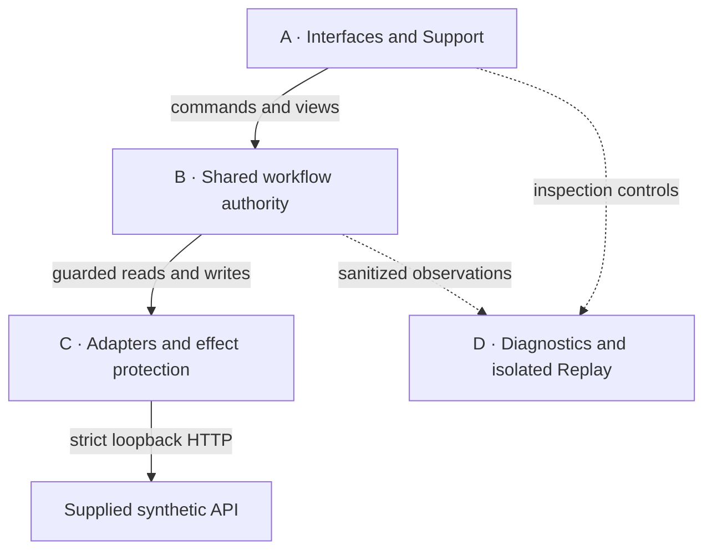
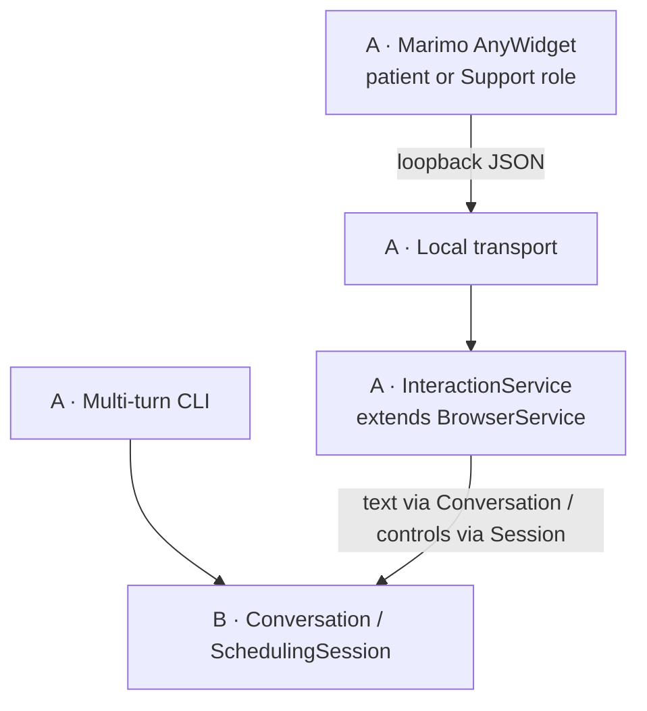
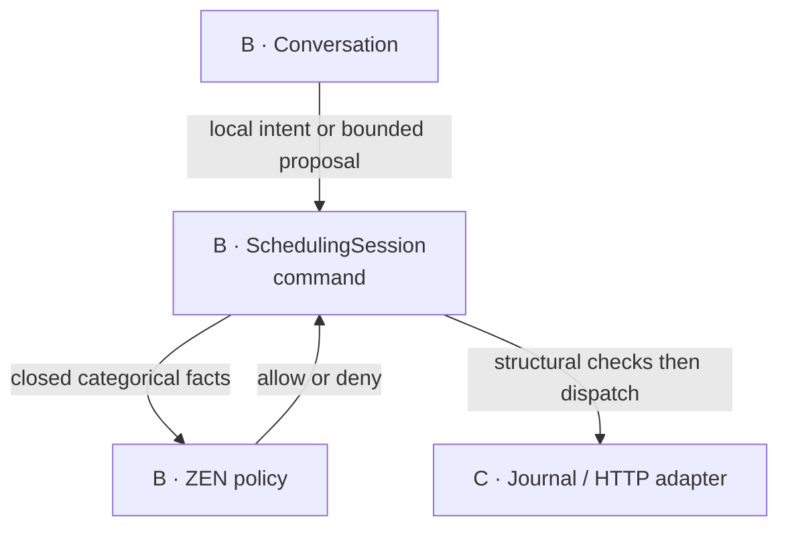
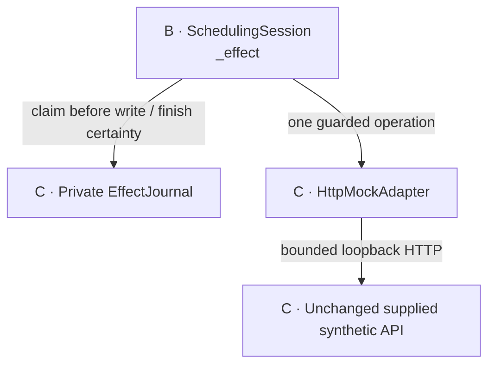
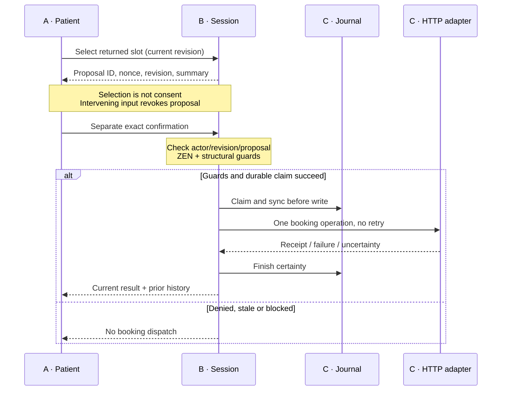
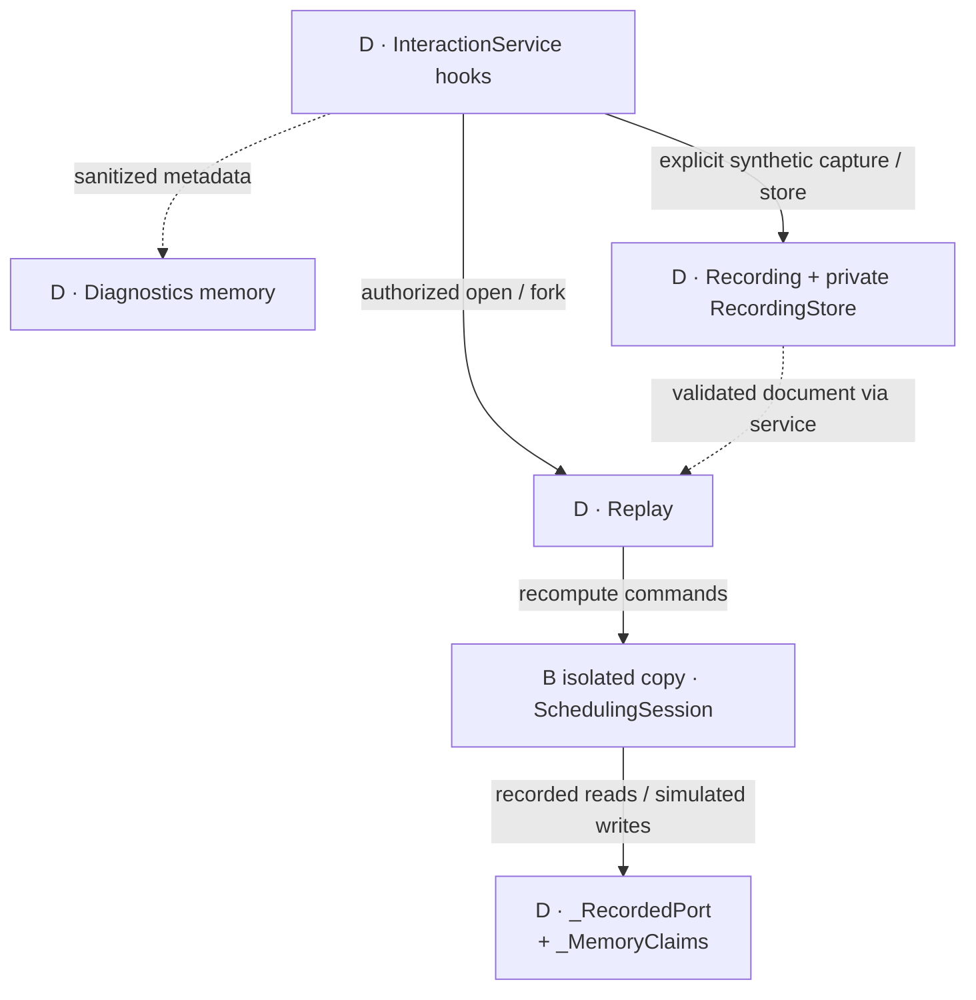

# As-built architecture

Updated 2026-10-13 against integrated baseline
`c7c53a3f45b9b6955a4f7b2d09b3a61a7828e1d1` plus the isolated L4/runtime-policy delta,
whose exact-head review/integration is pending in native T087–T097. This is the local synthetic
scheduling PoC as implemented, not a production design or deployment approval.
Earlier runtime repairs integrated through [PR #6](https://github.com/Kenerator/ochsner-scheduling-bob/pull/6);
budget/L3 through [PR #8](https://github.com/Kenerator/ochsner-scheduling-bob/pull/8).
The L4 launch boundary changes hosting/configuration, not domain authority.

Navigation: [overview](#components-and-authority) · [A interfaces](#a-interfaces-and-support) ·
[B workflow](#b-shared-workflow-and-confirmation-authority) ·
[C effects](#c-adapters-and-effect-protection) · [D inspection and Replay](#d-diagnostics-recording-and-isolated-replay) ·
[state/privacy](#state-privacy-and-persistence) · [limits](#limitations) ·
[history](#history-and-source-bound-evidence). For symbols/tests use the
[walkthrough](code-walkthrough.md); [spec](../../../specs/001-ochsner-scheduling-assistant/spec.md),
[plan](../../../specs/001-ochsner-scheduling-assistant/plan.md),
[decisions](../../product/decisions.md) and [native tasks](../../../specs/001-ochsner-scheduling-assistant/tasks.md)
retain requirements, design decisions and completion evidence respectively.

## Components and authority

Four review subsets organize the same system; they are not separate services or
exclusive class ownership. `InteractionService` spans A's browser orchestration
and D's observation hooks. Zoom-ins reuse A–D labels rather than adding a giant graph.



Solid arrows denote calls or routed requests; dotted arrows denote observation or
inspection data/control, **not permission delegation**. Responses return to the
caller unless explicitly drawn. These are logical relationships, not deployment
or network-trust diagrams. Only the live `SchedulingSession` authorizes booking/
handoff dispatch; C carries out and validates it. D's Replay uses a separate
simulation core and has no path back to the live session's authority or adapters.

## A: Interfaces and Support



[CLI](../../../src/ochsner_bob/__main__.py) uses shared `Conversation`;
[browser controls](../../../src/ochsner_bob/widget.js) go through
[transport](../../../src/ochsner_bob/local_transport.py) and the canonical service
outside Marimo kernels. Explicit controls can call Session through BrowserService;
not every command passes through Conversation. Host/Origin and closed JSON checks
protect the local transport, while role-bound capabilities are distinct from
diagnostic/recording references. Neither is production patient authentication.

The managed launcher starts the selected CLI or backend/viewer outside this
logical command diagram. Its private credential capture and process ownership
do not delegate booking authority. Only the actual model host receives the key;
the browser receives a validated public numeric-loopback backend trait.

Support sees the last acknowledged patient projection with freshness plus
separately labeled current context; confirmation nonces are removed. Pairing
membership and takeover control are distinct: joined/inactive is valid. Support
cannot issue identity, availability, appointment lookup, selection, confirmation
or handoff commands. Suggestions require active control/current revision, then
explicit patient adoption after return. Fresh means the acknowledged revision
is current and its age is under five seconds; the separate takeover lease lasts
at most 300 seconds. Poll/read/ack never dispatch models or
booking writes, although a read may expire a lease and revoke control/proposals.
See [browser observation and concurrency](#browser-observation-and-concurrency).

## B: Shared workflow and confirmation authority



[Conversation](../../../src/ochsner_bob/conversation.py) routes local Help/medical/
unsupported paths before model handling. [SchedulingSession](../../../src/ochsner_bob/session.py)
owns revision, actor restrictions, verified synthetic identity, filters, returned
options, proposal and outcome history. Corrections revoke dependent authority
before validation. Bounded invalid private candidates can be corrected without
silently restoring older valid values; no private I/O occurs until valid.

Public provider discovery requires no identity; private availability/history
requires a unique returned fixture match. [RapidFuzz](../../../src/ochsner_bob/suggestions.py)
suggests only public vocabulary/current public providers, never patients or
automatic selection. The real [ZEN graph](../../../policies/bob.json) receives
five closed facts; error/unknown facts deny. Policy allow never overrides actor,
identity, current proposal/nonce/revision or durable effect protection.

## C: Adapters and effect protection



[HttpMockAdapter](../../../src/ochsner_bob/http_mock.py) validates reads and matching
write receipts, permits numeric loopback HTTP with an explicit port only, and
uses bounded timeout/body with no proxy, redirect or retry. Booking checks the
submitted patient/provider/specialty/location/offset-aware `startTime`. Validated
400/409 writes are rejected; a schema/code-matching supplied 503 is a definite
failure. A raw POST 404 is not a recognized adapter error contract and remains
unknown. Separately, Session classifies an injected `ApiError(404)` as failed;
that unit-port behavior is not a strict HTTP guarantee. Lost/malformed/mismatched
possible-write receipts also remain unknown.

[EffectJournal](../../../src/ochsner_bob/journal.py) durably claims before POST.
Persisted attempted becomes unknown on reconstruction. Reset/reconnect/restart
in the same namespace cannot remove unresolved protection; missing/corrupt/unsafe
storage denies. This is local duplicate/crash protection, **not remote idempotency,
exactly-once delivery or reconciliation**. A handoff receipt means mock queued,
not delivery to staff. [OwnedMock](../../../scripts/mock_lifecycle.py) starts and
cleans only its own child, including interrupted acquisition; it does not manage
unrelated listeners. [Vendor provenance](../../../vendor/reference/PROVENANCE.md)
binds the unchanged supplied server and fixtures.

### Consent and write certainty

The focused sequence below concerns booking; handoff has its own guarded command
and no appointment-proposal confirmation. The private-field and support routes
cannot substitute for the dedicated patient confirmation.



## D: Diagnostics, recording and isolated Replay



[Diagnostics](../../../src/ochsner_bob/diagnostics.py) observes validated final API
outcomes and bounded public model disposition/context/timing independently of
capture. CLI `/diagnostics` and browser inspection do not invoke workflow effects.
An owned recording-OFF reference opens **current sanitized inspection**, not
historical Replay; grants are bounded, fixed-expiry and memory/session-scoped.
Unknown/foreign/ungranted references share a generic denial. The widget gives
reference-specific recovery without discarding a valid capability or retrying.

Patient-only, explicitly enabled synthetic [Recording](../../../src/ochsner_bob/replay.py) replaces private values with
approved host-fixture bindings and retains ordered original browser receipts.
These are observations, not regenerated pixels or confirmation authority.
[RecordingStore](../../../src/ochsner_bob/recording_store.py) is separate from
effect claims/model accounting. The diagram's document arrow is data passed by
InteractionService, not a direct RecordingStore-to-Replay call.

Replay reconstructs an isolated SchedulingSession with `_RecordedPort` and
`_MemoryClaims`, never the live HTTP/model/durable-journal adapters. Its simulation
can show completed or unknown outcomes without executing a live effect. Empty
read variants clear both result lists; contradictory historical empty imports
retain bytes/digest but disclose gaps and yield no results. Inspect/fork/compare/
fixture proposals cannot acquire live identity, nonces or consent. See the
[fidelity and retention contract](#replay-fidelity-and-retention).

## State, privacy and persistence

| State | Owner/lifetime | Boundary |
| --- | --- | --- |
| Identity, filters, returned options, proposal, receipts | SchedulingSession memory | Corrections revoke private state first; failed reads clear stale private rows. Latest attempted result is separate from prior copied receipts. Full identity/history is not restart-persisted. |
| Effect claims | Private EffectJournal file/lock/marker | Stable flock/thread lock, fsync/atomic replace; opaque keys only. Reset cannot clear uncertainty. |
| CLI effect namespace | Private adjacent `.cli-namespace.json` plus stable lock/marker | Same journal resumes opaque session ID only; lifetime exclusive lock, atomic 0600 persistence, per-turn binding checks and foreign-claim rejection. No legacy migration or identity/consent restoration. |
| Capability bindings | BrowserService private adjacent registry | Digests bind role/session/issuance; bounded count, 24-hour expiry. Restart restores effect namespace, not identity/consent. One-use five-minute pairing grants are memory-only. |
| Public draft/disclosure and bearer capability | Widget per-tab sessionStorage | Private identity drafts not stored/mirrored; capability never enters URLs/trace references. Not production authentication. |
| Last patient observation | BrowserService memory | Exact delivered response plus accepted semantic receipt; support nonce stripped, current server context separately labeled. |
| Takeover/suggestion | BrowserService/session memory | Fresh acknowledgement, five-minute lease; no support identity/select/confirm. Explicit patient preference adoption after return. |
| Captures/forks | Private RecordingStore envelopes | Typed synthetic projection, quota/TTL/tombstones/purge; separate from effects/budget. |
| Model accounting | One project `.bob-local/model-budget.json` | Durable private reservation before dispatch; missing/corrupt/unsafe state denies. No prompts, credentials or raw responses. |

ZEN hashes the exact loaded graph and uses five closed categorical facts;
engine/schema failure denies, allow never overrides structural guards. RapidFuzz
only suggests fixed public vocabularies/current returned public providers, never
patients or automatic selection. See [walkthrough boundary tests](code-walkthrough.md#boundary-modules).

## Browser observation and concurrency

Acknowledgement contains bounded revision/renderer/visible/public-draft/focus/
scroll/disclosure fields and must refer to an actually delivered response.
Optional strictly typed `presentation: {notice, pending, dirty, can_confirm}`
additionally mirrors categorical warning/pending/unsent-edit status and the
observed confirmation-enabled state, never arbitrary notice text or consent.
Legacy three-field presentation objects remain accepted by live acknowledgement;
missing can_confirm makes exact capture incomplete, not a fully observed control. This does not convert
semantic observation into pixel parity.
Support's read-only patient renderer uses `observed_patient`, with age/staleness,
not current server state mislabeled as seen. Both support projections strip the
confirmation nonce. Semantic receipts are not pixel parity or proof of human understanding.

InteractionService waits for language outside its global lock, binds results to
turn/revision and permits polling, other sessions and local safety controls.
Delivered views include final categorical notices. Widget safety buttons remain
usable during pending text; dirty edits disable exact-snapshot confirmation.
Poll/read/ack cannot schedule or invoke models, but reads may expire takeover
(revocation-only). Host/Origin and closed JSON schemas are checked. The shipped
widget sidecar URL is fixed at port 28451 (default UI origin 28450); launcher port
changes alone do not reconfigure it.

## Replay fidelity and retention

Capture observes actual session/API/language boundaries, replaces private values
with approved host fixture references and records categorical certainty. Late
capture, unrepresentable commands/fields, ambiguous fixture bindings, missed
outcomes and overflow report explicit gaps, not invented history. Provenance
binds revision, working source, policy, prompt, schema, fixtures and pinned project
metadata; hashes confer no trust and metadata is not a resolved dependency lock.

Source provenance uses Git HEAD only when Git resolves exactly to this project
root. Git-free archives use the fixed bounded regular
[archive revision artifact](../../../.git_archival.txt), substituted by the
additive `.gitattributes` export rule. Unexpanded/malformed metadata, symlinks,
hardlinks and broken own checkouts fail closed; an ancestor repository is not
this source. Archive working-tree state is explicitly unknown (conservatively
dirty for legacy boolean consumers), while actual bytes are independently hashed.
This is identifier/drift evidence, not a signature, clean-byte proof or wheel
qualification. [Provenance regressions](../../../tests/test_source_provenance.py)
exercise actual archive substitution and offline capture/replay without Git.

Replay runs the actual `SchedulingSession` using a fixed recorded-only port
and private in-memory effect claims. The default live constructor still
uses the durable EffectJournal. Every replay gets a fresh opaque namespace;
recorded fixture references resolve only against the approved host catalog.
Fresh simulation proposals supply only simulation-local confirmation values,
never imported IDs/nonces. The original's sanitized core projection is compared
after every command: missing evidence, fixture gaps, source drift or mismatches
prevent a `core_semantic_parity=true` claim. Legacy typed-interpreter recordings
remain inspection-only/incomplete, not silently upgraded.

Fidelity is `representation: scheduling_core_v1`, with independent
`core_semantic_parity` and `core_renderer_parity=false` flags. Matching complete
captures reproduce categorical core state, revisions, preferences, option counts,
proposal presence, policy decisions and outcome/uncertainty history. They do not
reproduce private records/receipt identifiers or execute the browser renderer.
Ordered original browser receipts (including public drafts/focus/disclosures and
categorical presentation) are retained separately as `observed_views` when captured, not reconstructed
by core parity. Missing/partial required receipts make capture incomplete even
when core parity matches. The replay panel is not the complete browser renderer.
Compound language commands retain their recorded cause; changing the model category
does not apply old model-generated commands. Variants recompute actual core guards
but unchanged recorded API outcomes are explicitly counterfactual stubs, not
historical parity or a newly qualified API/model experiment.

Step/back/jump/play/tick/bookmark/fork/compare/regression proposals cannot reach
live HTTP/models/durable effect journals. Typed forks preserve immutable lineage and recompute
prerequisites without supplying live authority. References are locators, not
capabilities; service access grants are memory-only/session-scoped. Restart keeps
private files, not automatic grants. Reviewed exports remain untrusted input.

Defaults: imports 1 MiB, 2,000 events, depth 12, strings 4,096 characters; each
recording 10 MiB, aggregate 100 MiB, TTL 24 hours. Oversize exports report inability
to reimport, not truncation. Strict imports reject private/authority/unknown fields,
duplicate keys, nonfinite values and executable/endpoint configuration. Replay/store
access checks expiry; store operations sweep expiry and explicit expire/purge
APIs exist. Tombstones retain
expiry status without payload; purge does not erase journals/budgets/unrelated
files. Importing an external export cannot revive the same purged/tombstoned
reference. Quota failure does not silently evict active captures. Evidence:
[replay](../../../tests/test_replay_contract.py), [store](../../../tests/test_recording_store.py),
[capture integration](../../../tests/test_interaction_service.py).
The [same-core regressions](../../../tests/test_replay_live_core.py) additionally
disable socket access, disk-journal construction and the legacy interpreter while
replaying actual supplied-HTTP capture; live state, write count and journal bytes
remain unchanged. They cover success/rejection/failure/unknown, identity ambiguity,
invalid correction, stale confirmation, takeover and typed variants.
The integrated `InteractionService.maintain_retention()` hook sweeps expired idle
replays, active captures and stored payloads, including restored stores, without
creating an unused recording store. Corrupt storage is preserved/reported while
expired memory is purged first. A host must schedule this hook to guarantee idle
cleanup without traffic. The integrated launcher assigns it to the server's
`service_actions`, invoked by the serve-forever poll loop even without patient
requests; no separate detached daemon or external scheduler is introduced.

Retention sweeps recording payloads, active captures and open Replay memory;
it is not blanket erasure of session identity/diagnostics, capabilities, effect
journals or model accounting.

## Optional language

Offline deterministic interpretation is default. Explicit CLI/browser `--openai`
constructs LanguageAdapter plus the canonical project ModelBudget; construction/
view does not dispatch or reserve. Runtime `BOB_ENABLE_OPENAI`, `BOB_OPENAI_MODEL`,
`OPENAI_API_KEY` gates still apply. Safety/privacy routing precedes model input;
only public text/preferences/workflow is supplied. Closed structured proposals
cannot supply identity/slot authority/consent. Bounded direct HTTPS, no tools,
redirects or retries; failures are explicit, not silent offline fallback.

Application runtime constructors select indefinite uncapped accounting, while
functional qualification/testing/validation/app-like evaluation shares that policy;
excluded LLM code-generation configuration stays unchanged. The same canonical
path reserves worst-case
priced context plus bounded output before dispatch and settles validated numeric
usage only. Unknown billing/crashes retain reservations; calls never refund.
Another path cannot enforce the shared grant or legitimately replenish it. No
account-wide invoice reconciliation is claimed.
See [genuine qualification](../live-qualification.md) for separately source-bound
model results; no live model call is part of this documentation change.

## Fixed-day budget candidate — 2026-10-12

Historical source-bound mechanism; superseded for application runtime by the
Oct 13 section below. The old launcher flag is retired, not a current requirement.

Updated 2026-10-12: reviewed head `8908ef9`, integrated as `c7c53a3` through
protected PR #8. Review, exact-head CI and local backend restoration evidence are
in [native tasks](../../../specs/001-ochsner-scheduling-assistant/tasks.md#fixed-day-bob-budget-candidate--2026-10-12).
[ModelBudget](../../../src/ochsner_bob/model_budget.py) adds a fixed, half-open Oct 12
Central window affecting new-reservation numeric policy only. Structural reads,
late settlement, unknown liability, canonical path, private locks and atomic
persistence remain. The 100,000-byte bound is enforced before writes, including
worst-case outstanding-settlement headroom. Public `preflight_budget` opens only
existing ledger/marker state and prepares in memory; it cannot dispatch or write.
At that historical source CLI/browser required explicit `--openai --unlimited-today`;
shared launch was SM-owned.
No diagram/component topology changes.

[Window tests](../../../tests/test_budget_window.py),
[launch tests](../../../tests/test_budget_window_launch.py), and
[readiness tests](../../../tests/test_budget_preflight.py) cover fixed clocks,
over-cap late accounting, explicit flag plumbing and unchanged bytes/file identity.
These are offline tests; the separate backend restoration made no paid model request.
[User guidance](../../user/getting-started.md#fixed-oct-12-model-budget-window) explains
expiry and older-reader incompatibility; never reset/truncate an over-cap ledger.

## Indefinite runtime accounting — 2026-10-13

Candidate source on integrated baseline `c7c53a3`; final reviewed revision/status
is pending in [native tasks](../../../specs/001-ochsner-scheduling-assistant/tasks.md#indefinite-runtime-policy--2026-10-13).
[RuntimeLedger](../../../src/ochsner_bob/runtime_accounting.py) is a storage adapter
behind ModelBudget, not new model or scheduling authority. Actual CLI/browser
constructors and the functional qualifier select uncapped covered-execution policy.
The qualifier privately reuses the pinned exact Ochsner notes resolver and rejects
off-canonical accounting; explicit live opt-in remains. Generic non-application
callers/build-agent configuration do not inherit new generation permissions.
Private SQLite uses the same canonical ledger path and stable flock/marker;
atomic migration copies every JSON history row with original IDs/configuration.
Indexed inserts/updates retain unknown/reserved liabilities and late settlements
without a cumulative record cutoff. SQLite FULL transactions and directory fsync
precede reservation return. DELETE journals are checked private; WAL/SHM/unexpected
companions, malformed rows/schema, unsafe storage and genuine I/O failures deny.
External file changes require complete bounded-memory validation before dispatch.
Readiness validates old/new formats read-only; it never migrates or grants a call.
Activate only with old writers quiescent; no live-format migration is performed.

## Limitations

L4 consumer candidate, updated 2026-10-12 on integrated baseline `c7c53a3`:
the managed [runtime manifest](../../../tools/poc-runtime/export-manifest.json)
pins authoritative launcher bytes and [BOB config](../../../poc-launch.json)
selects real model mode/default snapshot/exact Secure Note field. Preflight is
no-call; the key is captured only after readiness and supplied only to the model
host. The viewer gets a validated public transport URL and the nested mock stays
secret-free. Domain and effect authority are unchanged; runtime accounting policy
is updated separately above. Actual isolated
offline UI creation/provider discovery succeeded on 29580/29581; IAB reconnect
and acknowledgement warnings remain, not synchronized-screen qualification.
The reviewed CLI ownership correction is adopted and consumer tests pass; final
combined review/integration remain pending in
[native tasks](../../../specs/001-ochsner-scheduling-assistant/tasks.md#l4-model-first-consumer--2026-10-12).

This is an internal-use, synthetic local PoC with approved public source and
retained branded assets—not production authentication, clinical advice, real
staff routing, application deployment, external media publication or endorsement.
Core semantic parity is conditional on complete matching evidence; renderer
parity stays false. Imported hashes identify bytes, not authentic history.
Local effect protection does not reconcile a remote unknown write. Model usage
reservations are conservative accounting, not account-wide invoice reconciliation.
Mac ARM is the required product target; offline Linux CI is additional runner
evidence, not browser/mobile/assistive-technology or platform-wide acceptance.
Current tests/CI and historical manual-browser/model results retain their own
source/method limits in [native tasks](../../../specs/001-ochsner-scheduling-assistant/tasks.md)
and the history below. Diagram rendering is documentation QA, not product UAT.

## History and source-bound evidence

The following dated checkpoints are preserved historical records. Their candidate,
pending-integration, counts, digests and rendered-diagram statements describe
those sources at those times—not the current integrated source or these diagrams.
Current organization/source accuracy is reviewed against the revision at the top.

## Adversarial repair delta — 2026-10-10

Updated against runtime/test source `f7f852c613e306123041866b379a093255582543`;
independent candidate review/integration remain pending in
[native T064–T069](../../../specs/001-ochsner-scheduling-assistant/tasks.md).
Topology and effect authority are unchanged. Replay empty variants clear both
recorded result lists; the recorded-only port also returns no results for empty.
Contradictory historical imports retain their bytes/digest but disclose incomplete
evidence instead of trusting retained fixtures. No live fallback is introduced.
Private identity candidates retain bounded invalid corrections separately from
verified authority; every edit still revokes identity/results/proposal before
validation and no read occurs until the whole candidate is valid.

Unavailable Replay references use one anti-enumeration category, independent of
capability/pairing denial. The widget mirrors a fixed categorical recovery notice;
no reference existence, private input or authority is added to acknowledgements.
Unsuccessful mock acquisition cleans only its owned child and pipe descriptors,
preserving cancellation. Boundary regressions:
[empty Replay](../../../tests/test_replay_empty.py),
[identity recovery](../../../tests/test_identity_draft_recovery.py),
[mock acquisition](../../../tests/test_mock_acquisition.py),
[HTTP denial/notice](../../../tests/test_local_transport.py) and
[shipped renderer](../../../tests/test_widget_projection.py).
These are offline contracts, not new browser/capture/accessibility evidence;
existing diagram topology and historical rendered-source claims below are unchanged.

## Stage-one quality delta — 2026-10-10

Updated/reviewed runtime/test source:
`56fc4e8bc10ec4a15dc2befabb76208f2d64a807` (candidate, not an integrated RC).
`InteractionService._summary` publishes bounded memory-only OFF inspection grants;
`_open_off_inspection` checks session ownership and fixed expiry, then exposes
current sanitized events/API/model metadata with requested/current revisions.
It is not historical state, RecordingStore, full replay, fork or exact export.
Opening it clears the caller's previous in-memory replay target. Paired Support
retains the same session-scoped diagnostic access; foreign patients do not.
[Six OFF-reference contracts](../../../tests/test_off_reference.py) cover no
effects/storage, privacy, expiry/no renewal, bounded history and replay switching.

Widget browser ESM bytes are unchanged, now explicitly classified by
[package.json](../../../src/ochsner_bob/package.json) for Node verification.
The [offline workflow](../../../.github/workflows/bob-offline.yml) uses the
[adapted profile](../qualification.json), standard Ubuntu, compatible Python/Node
and official full-SHA actions with a read-only token; actual run status belongs
in [native tasks](../../../specs/001-ochsner-scheduling-assistant/tasks.md).
No diagram topology/effect-authority change: sanitized inspection is internal to
InteractionService and does not follow the recording-store arrow. Existing
diagrams retain their historical rendered-source qualification below.

## Completeness delta — 2026-10-10

Updated/reviewed 2026-10-10. Code/test source
`c8463252251dd840ac443641702656fd3134eebc` / immutable RC-2; repair base `00ed37d`.
415 tests and all three booking demos plus starter success/failure passed.
Whole-diff findings repaired; independent delta review clear. Native T056 holds
the [protected PR](https://github.com/Kenerator/ochsner-scheduling-bob/pull/3)
handoff and qualification limits.
[Diagnostics](../../../src/ochsner_bob/diagnostics.py) observes validated API
outcomes (not a bare HTTP 201) and public model context/disposition/timing through
actual CLI/InteractionService constructors, independently of exact recording.
Per-session bounded memory and categorical drop counts keep raw identity,
inputs/output, receipts and exceptions out of diagnostics. CLI `/diagnostics`
and browser inspection are effect-free.

[Recording/Replay](../../../src/ochsner_bob/replay.py) now retain bounded ordered
browser receipts bound to delivered core-step revisions. Presentation includes
notice/loading/dirty/confirmation-enabled observations; drafts/focus/disclosures
remain public-only. They are original observations, never variant predictions
or confirmation authority. Required missing/legacy partial receipts make capture
incomplete while core parity is reported independently. Strict import, TTL,
aggregate limits and isolated core effects remain in force, including required
receipt markers. Ordering/clock variants drop original receipts rather than
transplanting them to different commands or simulation clocks. Imported drafts
also pass the live privacy/opaque-ID gate. Capture completeness is an internal
schema/evidence assessment, not authenticity: a re-signed imported document is
still untrusted history, and its digest confers no authority or browser proof.
Model metadata publishes under the service freshness lock; delayed older
revisions cannot replace newer diagnostics. Source-accuracy clarification (2026-10-12): an injected Session ApiError(404)
is failure, not rejection; raw HTTP POST 404 remains unknown under the strict
adapter. Recognized 400/409 writes remain rejection and lost/malformed receipts
remain unknown. No historical execution result is changed by this clarification.
Tests: [receipt contracts](../../../tests/test_view_receipt_capture.py),
[recording-OFF constructors](../../../tests/test_live_diagnostics.py).
Topology/authority diagrams below are unchanged; their source/count paragraphs
remain historical RC-1 evidence, not new qualification.

Historical checkpoint reviewed 2026-10-10: code/test source `e2dfa7e9f471513921063d568bb3bc890eff1800` (RC-1).
Documentation finalized after that tested source checkpoint. [Walkthrough](code-walkthrough.md),
[spec](../../../specs/001-ochsner-scheduling-assistant/spec.md),
[plan](../../../specs/001-ochsner-scheduling-assistant/plan.md),
[native task ledger](../../../specs/001-ochsner-scheduling-assistant/tasks.md),
[decisions](../../product/decisions.md). This describes actual source, not deployment readiness.

### RC-1 component evidence — 2026-10-10

The 2026-10-10 repair retains this topology and all live effect/privacy boundaries.
[Post-booking replay tests](../../../tests/test_post_booking_replay.py) cover
validated dynamic appointment rows: capture binds each complete row to the current
approved synthetic identity and a unique approved public slot, rather than
persisting private rows or requiring a static appointment ID. Replay constructs
simulation-only placeholder receipts through its recorded-only port; invalid,
ambiguous or foreign rows remain incomplete. This is not live receipt replay.

[Support status tests](../../../tests/test_support_status.py) separate BrowserService's
resolved paired role (`joined`) from SchedulingSession's control lease
(`active`/`inactive`). The session alone reports membership unknown; it cannot
infer a browser binding. Lease expiry/Return ends control, not pairing. Widget
status remains visible before the first acknowledged patient screen. No private
identity, selection or confirmation authority is added. Parent and clean committed
export both passed 398 tests and all three demos; actual browser evidence and
renderer-parity limits are [separately source-bound](../video-notes.md#feature-completion-supplement--2026-10-10).


## Reviewed source and verification

Historical reviewed code/test source `5e7ae0c6b1ae29d198f734a0c26e2c96e525b961`, 2026-10-09.
The following digests/results remain bound to that earlier milestone, not RC-1;
current repair evidence is linked above and in the native task ledger.
Clean committed-export qualification passed. Digests identify inspected bytes,
not production approval or a dependency lock:

| Snapshot | SHA-256 | Scope |
| --- | --- | --- |
| Integration code manifest | `b555b5b6cf8439377f07d1b1892eb2f4f2dae83214cf6e34dd0876c17654e554` | Sorted path/SHA-256 lines: `.py/.js/.mjs/.json` under src/ochsner_bob, apps, scripts, policies; includes sketches/probes, excludes docs/assets/vendor/dependency metadata. |
| Test code manifest | `d700c79e03e65b0ff788e8ca840952b46b203411115c5017c343e605273935e3` | Same method: `.py/.mjs` under tests; excludes JSON/YAML fixture bytes. |
| Native capture source | `118327af911fccf9cadb6a94c80432f830b70b15fb80a289341b5783b06f4aca` | build_provenance `_SOURCE` order: session, conversation, browser_service, interaction_service, replay, recording_store, journal, policy, language, http_mock `.py`; excludes CLI namespace/budget/widget/launchers. |

Reproduce broader manifests from the repository root; filename lines and their
final newlines are part of the hash:

```sh
rg --files src/ochsner_bob apps scripts policies -g '*.py' -g '*.js' -g '*.mjs' -g '*.json' | LC_ALL=C sort | xargs shasum -a 256 | shasum -a 256
rg --files tests -g '*.py' -g '*.mjs' | LC_ALL=C sort | xargs shasum -a 256 | shasum -a 256
```

Native capture instead hashes fixed-order NUL-separated filename + NUL + bytes
entries. Its fixture digest also reflects locally materialized relative-date
slots. Future source changes require a refreshed dated snapshot.

Fresh review evidence, 2026-10-09:

- Explicit `/Users/ken/codeRepos/ochsner-scheduling-bob/.venv/bin/python`, Python
  3.11.13; `PYTHONDONTWRITEBYTECODE=1 PYTHONPATH=src` and
  `-m unittest discover -s tests -v`: **387 tests passed, 21.155 seconds**, including same-core replay, archive
  provenance and explicit unknown legacy-observation labels.
  Historical/unit fixtures are included; not every test is acceptance evidence.
- `scripts/demo_booking.py --flow all` passed using that interpreter: supplied
  success completed, supplied conflict rejected then freshly completed, and the
  explicitly labeled accepted-write/hidden-receipt adapter fault stayed unknown
  with retry blocked. Unknown is not a supplied scenario.
- **75 local Markdown links/anchors** passed the earlier bounded validation;
  a later clean-export navigation audit is tracked separately in the task ledger.
  Parent subsequently rendered both actual Mermaid blocks through local Marimo
  in Chrome. A sequence-note semicolon caused a real parser failure, was replaced
  with a period, and both diagrams then rendered without parse errors. Visual
  inspection confirmed readable component labels, consent/claim ordering and
  completed/rejected/failed/unknown branches. Large diagrams require scrolling;
  this is not mobile or assistive-technology qualification.
- [Widget tests](../../../tests/test_widget_projection.py) use the shipped JS
  with a [minimal DOM/fetch harness](../../../tests/widget_harness.mjs), not actual
  browser/accessibility qualification. The genuine [early Marimo probe](../marimo-feasibility.md)
  predates the full UI and retains a server-replacement reconnect caveat; final
  paired renderer/reconnect fidelity is not inferred from it or replay.
- Subsequent parent report, 2026-10-09: the actual final UI passed capture → Help
  → discover → seal → open → step. This worker did not rerun that browser journey.
  It is scoped actual-UI evidence for those controls, not proof of full paired
  renderer/reconnect/accessibility qualification or semantic replay/core parity.
- Separately [recorded local HTTP performance](../performance-notes.md): parent
  measured 30 sequential requests on Darwin arm64/Python 3.11.13, p50 0.931 ms,
  p95 2.163 ms, max 2.358 ms, no model calls/effects. The real transport/shared
  Conversation/Session sample alternates public supplied-HTTP discovery and local
  Help; it measures decoded HTTP completion, not browser paint, internet latency,
  concurrency/capacity or model response time. This worker inspected the
  [measurement path](../../../scripts/measure_local.py), not a new benchmark run.

CLI restart regression was reproduced before its fix: initial 17 tests had 14
failures, including booking/handoff each dispatching a second write on same-journal
main reentry; an additional foreign-namespace-binding test was also observed red.
All 18 [restart tests](../../../tests/test_cli_restart.py) now pass through actual
main with an explicitly labeled unknown-write unit port. They cover unchanged
write count, Help/reset, no identity/consent restoration, thread/process exclusion,
lost/corrupt/unsafe state and legacy rejection. Existing legacy journals are
blocked, not silently migrated; preserve their files for explicit reconciliation.
Same `--journal` resumes protection. A genuinely new synthetic mock run uses an
explicit new `--journal` path, not deletion/reset of the old protected namespace.
These are launcher tests, not supplied-service or remote-idempotency evidence.
Native tasks/integration review own other remaining work.
No live human delivery, production authentication, browser-renderer replay parity
or deployment readiness is claimed.

Final clean-source qualification on `5e7ae0c6b1ae29d198f734a0c26e2c96e525b961`: fresh Python 3.11.13
arm64 venv/editable install, 387 tests (19.282 s), 9 supplied-HTTP checks including
all eight exact scenarios, success/conflict/unknown demos and 6 widget boundary
checks passed. Profile SHA-256 `360b20ef914961240f58812111a0bbcdb1fa835ff48425a1986ab640164b2e1f`.
This native helper does not claim browser/live-model/remote-clone coverage; actual
manual browser and genuine-language evidence retain their separate source limits.
The earlier export failure at 9625185 is retained in the native task ledger.

Refreshed source-bound performance at this revision: 30 sequential loopback
requests, p50 1.202 ms, p95 2.807 ms, max 2.849 ms, zero effects/model calls.
It is decoded HTTP completion, not browser paint or a capacity/SLA guarantee.
