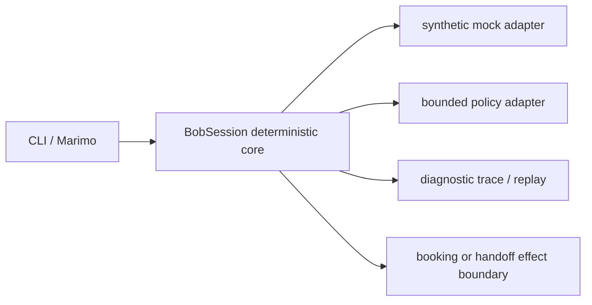

# As-built architecture

Updated: 2026-10-09. Reviewed source revision: working tree, pre-commit.
Status: partial as-built record; remaining UI/support/HTTP qualification is tracked in native tasks.md.

## Components and boundaries

The deterministic core in `src/ochsner_bob/core.py` owns session state, identity
revocation, proposal/confirmation, booking certainty, and mock handoff receipts.
`adapters.py` bounds language and policy inputs; `replay.py` never executes effects;
`apps/scheduling_app.py` is a thin optional Marimo adapter. All current data is
synthetic/in-memory. See the [code walkthrough](code-walkthrough.md).

## Diagrams

The confirmation/effect boundary is inside `BobSession.book`; replay and diagnostics
are projections and do not cross it. Mermaid rendering is unverified.

## Operational limits

State is in-memory and synthetic. Unknown booking/handoff results latch and block
automatic retry. Reset/restart durability, real authentication, live human delivery,
full paired support UI, genuine model qualification, and supplied HTTP process
integration remain incomplete and are not claimed.

Populate near the end of implementation alongside the walkthrough, not before
coding may start. Planned architecture remains in Spec-Kit `plan.md`; this file
describes what was actually built. Keep it short and update affected sections.
Link the relevant [milestone](../milestones.md) and actual
[theme/asset index](../ui-assets.md) when applicable; do not duplicate their tables.
