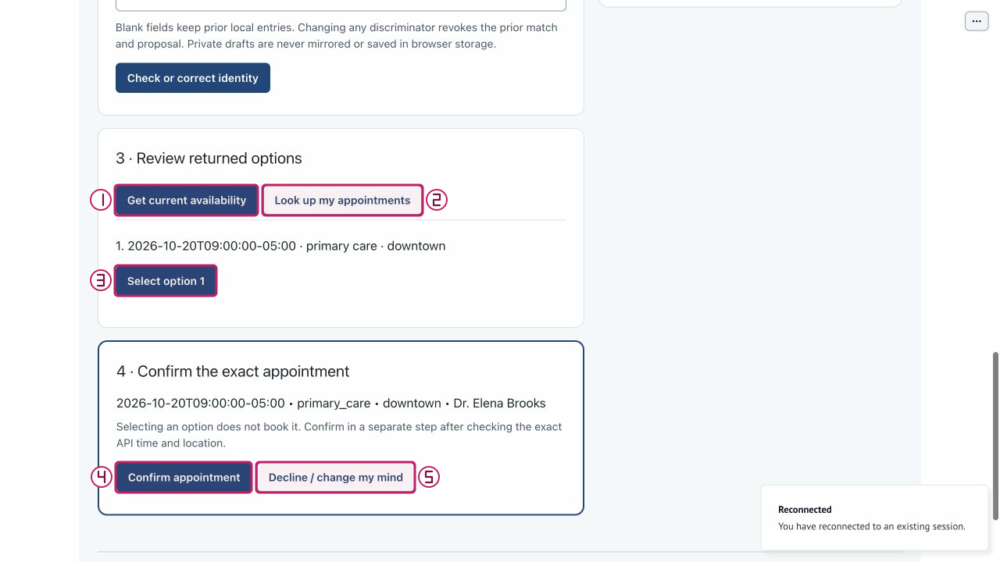

# Private identity and explicit booking

Use the numbered actual screenshots to locate controls; the text below is the
readable equivalent. Actions remain guarded by the application, not these figures.
New captures are isolated **offline**, at source `bdc4585` (2026-10-13), not genuine
model qualification. Historical figures retain their original 2026-10-10 source
and are labeled explicitly. [Manifest](../../../assets/ui/walkthroughs/manifest.json)
contains exact original/layer hashes, dimensions, source and placement rectangles.

## Role, prerequisites and effects

See the [shared disabled-state matrix](index.md#disabled-conditions-and-effect-scope)
and [role/state inventory](index.md#accessible-roles-and-required-atlas-states).
A visible or focused button is not permission. Patient confirmation, private drafts,
unknown-effect protection and replay isolation remain application-owned.

## Numbered figures

### private entry

Actual isolated offline capture: source `bdc4585`, role patient.
Approved synthetic drafts, not yet submitted; identity missing; no confirmation

| Number | Control / observation | What it does and important boundary |
|---|---|---|
| 1 | `2 · Private synthetic identity` | Expand/collapse local identity fields; disclosure itself supplies no identity or authority. |
| 2 | `Synthetic phone` | Enter exact supplied fixture phone, e.g. 555-0101; private draft is not mirrored or model input. |
| 3 | `Date of birth` | Enter supplied fixture DOB, e.g. 1985-04-12; format/date must be valid. |
| 4 | `ZIP discriminator` | Enter the five-digit fixture ZIP, e.g. 70112. Corrections revoke prior private authority. |
| 5 | `Check or correct identity` | Validate/correct local discriminators. Blank fields preserve prior local entries; valid match clears entered UI drafts. |

[Unchanged original](../../../assets/ui/walkthroughs/control-atlas/private-identity.jpg) · [Separate vector layer](../../../assets/ui/walkthroughs/control-atlas/private-entry-annotation.svg).
Open the full-size figure when small labels are hard to read; numbered text remains
usable at document width. Original pixels are not edited, and no crop hides a warning.

### returned options and confirm

Actual isolated offline capture: source `bdc4585`, role patient.
Exact API time 2026-10-20T09:00:00-05:00; separate Confirm enabled, not booked

| Number | Control / observation | What it does and important boundary |
|---|---|---|
| 1 | `Get current availability` | Read returned slots only with current verified identity; failed refresh clears stale options/proposal. |
| 2 | `Look up my appointments` | Read only the current verified fixture's appointments; empty, not-found and outage are distinct. |
| 3 | `Select option {number}` | Select a returned numbered slot to form an exact proposal; selection is not a booking. |
| 4 | `Confirm appointment` | Perform the separate current explicit confirmation; disabled for stale/dirty/missing/unknown/Support authority. |
| 5 | `Decline / change my mind` | Revoke the current proposal; prior completed/unknown history is not erased. |

[Unchanged original](../../../assets/ui/walkthroughs/control-atlas/exact-proposal.jpg) · [Separate vector layer](../../../assets/ui/walkthroughs/control-atlas/returned-options-and-confirm-annotation.svg).
Open the full-size figure when small labels are hard to read; numbered text remains
usable at document width. Original pixels are not edited, and no crop hides a warning.

## Complete control index

| Catalog ID | Local actor | Accessible label | Purpose |
|---|---|---|---|
| `private-disclosure` | both | 2 · Private synthetic identity | Expand/collapse local identity fields; disclosure itself supplies no identity or authority. |
| `synthetic-phone` | patient | Synthetic phone | Enter exact supplied fixture phone, e.g. 555-0101; private draft is not mirrored or model input. |
| `date-of-birth` | patient | Date of birth | Enter supplied fixture DOB, e.g. 1985-04-12; format/date must be valid. |
| `zip-discriminator` | patient | ZIP discriminator | Enter the five-digit fixture ZIP, e.g. 70112. Corrections revoke prior private authority. |
| `check-identity` | patient | Check or correct identity | Validate/correct local discriminators. Blank fields preserve prior local entries; valid match clears entered UI drafts. |
| `get-availability` | patient | Get current availability | Read returned slots only with current verified identity; failed refresh clears stale options/proposal. |
| `lookup-appointments` | patient | Look up my appointments | Read only the current verified fixture's appointments; empty, not-found and outage are distinct. |
| `select-option` | patient | Select option {number} | Select a returned numbered slot to form an exact proposal; selection is not a booking. |
| `confirm-appointment` | patient | Confirm appointment | Perform the separate current explicit confirmation; disabled for stale/dirty/missing/unknown/Support authority. |
| `decline` | patient | Decline / change my mind | Revoke the current proposal; prior completed/unknown history is not erased. |

## Known gaps and recovery

- Acknowledgement-unavailable and transient kernel/reconnect warnings occurred.
  Joined role does not prove synchronized screens; compare the acknowledged revision
  with current context. Do not retry an unknown write.
- Reconnect can clear displayed diagnostics or reset the replay index. Review the
  actual state and re-enter a bounded index/reference; do not infer that a queued
  action or intended preference change succeeded.
- Historical Support screenshots explain unchanged controls/lease labels, not a
  fresh takeover or Support-sync test. Current captures did not take control, purge
  a recording or call a model. The data-controls plate shows locations, not proof
  every export/import action was executed.
- OFF controls are visible even if reconnect cleared the output. Inspect again
  for current sanitized diagnostics; never replace them with a saved exact transcript.
- These desktop figures are not mobile, screen-reader or production certification.

## Revision history

- 2026-10-13: Source-bound clean originals, separate vector layers/composites and
  numbered text equivalents prepared; independent final review/integration remain
  in [native tasks](../../../specs/001-ochsner-scheduling-assistant/tasks.md).

## References

- [Control inventory](index.md)
- [Walkthrough collection](../walkthroughs/index.md)
- [Native requirements](../../../specs/001-ochsner-scheduling-assistant/spec.md)
- [Historical still provenance](../../../assets/ui/stills/feature-completion-20261010/manifest.json)
