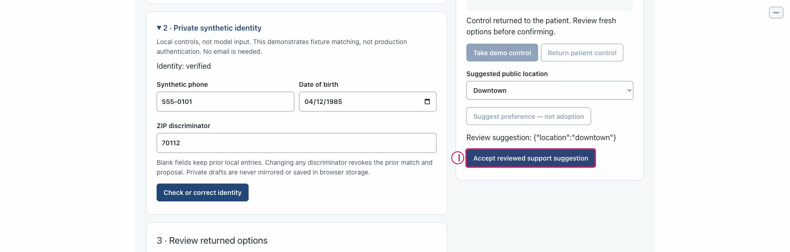

# Paired Support and control leases

Use the numbered actual screenshots to locate controls; the text below is the
readable equivalent. Actions remain guarded by the application, not these figures.
New captures are isolated **offline**, at source `bdc4585` (2026-10-13), not genuine
model qualification. Historical figures retain their original 2026-10-10 source
and are labeled explicitly. [Manifest](../../../assets/ui/walkthroughs/manifest.json)
contains exact original/layer hashes, dimensions, source and placement rectangles.

## Role, prerequisites and effects

See the [shared disabled-state matrix](index.md#disabled-conditions-and-effect-scope)
and [role/state inventory](index.md#accessible-roles-and-required-atlas-states).
A visible or focused button is not permission. Patient confirmation, private drafts,
unknown-effect protection and replay isolation remain application-owned.

## Numbered figures

### toolbar

Actual isolated offline capture: source `bdc4585`, role patient.
Empty join field; no pairing grant; patient controls disabled

| Number | Control / observation | What it does and important boundary |
|---|---|---|
| 1 | `Start independent patient` | Start a separate local patient session; does not reconnect the old patient or clear its effect history. |
| 2 | `One-use pairing grant` | Enter the patient's one-use local grant only in this private join field; never publish it. |
| 3 | `Join demo support` | Consume a current one-use grant to join read-only Support; private identity/confirmation excluded. |
| 4 | `Create support pairing grant` | Patient-only creation of a short-lived one-use local Support grant; do not capture its value. |

[Unchanged original](../../../assets/ui/walkthroughs/control-atlas/empty-toolbar.jpg) · [Separate vector layer](../../../assets/ui/walkthroughs/control-atlas/toolbar-annotation.svg).
Open the full-size figure when small labels are hard to read; numbered text remains
usable at document width. Original pixels are not edited, and no crop hides a warning.

### support actions

Historical executed synthetic capture: source `c3e6df2`, role support.
Historical executed synthetic state shown in the retained original, not a fresh run.

| Number | Control / observation | What it does and important boundary |
|---|---|---|
| 1 | `Take demo control` | Fresh paired Support starts a temporary demo lease; it does not obtain patient identity/confirmation. |
| 2 | `Return patient control` | Return the temporary lease to patient; membership remains joined, lease becomes inactive/zero. |
| 3 | `Suggested public location` | Support chooses a public suggestion value; it does not change patient preferences by itself. |
| 4 | `Suggest preference — not adoption` | Active Support proposes a public preference; proposal is not adoption or consent. |

[Unchanged original](../../../assets/ui/stills/feature-completion-20261010/S05-support-takeover.jpg) · [Separate vector layer](../../../assets/ui/walkthroughs/control-atlas/support-actions-annotation.svg).
Open the full-size figure when small labels are hard to read; numbered text remains
usable at document width. Original pixels are not edited, and no crop hides a warning.

### patient adoption

Historical executed synthetic capture: source `c3e6df2`, role patient.
Historical executed synthetic state shown in the retained original, not a fresh run.

| Number | Control / observation | What it does and important boundary |
|---|---|---|
| 1 | `Accept reviewed support suggestion` | Patient explicitly accepts a reviewed pending suggestion after control returns; stale proposal is invalidated. |

[Unchanged original](../../../assets/ui/stills/feature-completion-20261010/S23-patient-returned-can-accept.jpg) · [Separate vector layer](../../../assets/ui/walkthroughs/control-atlas/patient-adoption-annotation.svg).
Open the full-size figure when small labels are hard to read; numbered text remains
usable at document width. Original pixels are not edited, and no crop hides a warning.

### support joined state

Historical executed synthetic capture: source `e2dfa7e`, role support.
Historical executed synthetic state shown in the retained original, not a fresh run.

| Number | Control / observation | What it does and important boundary |
|---|---|---|
| 1 | Joined / lease state (not a control) | Local membership and active/inactive lease are separate. Pairing never grants private identity or confirmation. |

[Unchanged original](../../../assets/ui/stills/feature-completion-20261010/S30-fixed-paired-control-inactive.jpg) · [Separate vector layer](../../../assets/ui/walkthroughs/control-atlas/support-joined-state-annotation.svg).
Open the full-size figure when small labels are hard to read; numbered text remains
usable at document width. Original pixels are not edited, and no crop hides a warning.

### support active state

Historical executed synthetic capture: source `e2dfa7e`, role support.
Historical executed synthetic state shown in the retained original, not a fresh run.

| Number | Control / observation | What it does and important boundary |
|---|---|---|
| 1 | Joined / lease state (not a control) | Local membership and active/inactive lease are separate. Pairing never grants private identity or confirmation. |

[Unchanged original](../../../assets/ui/stills/feature-completion-20261010/S31-fixed-active-control.jpg) · [Separate vector layer](../../../assets/ui/walkthroughs/control-atlas/support-active-state-annotation.svg).
Open the full-size figure when small labels are hard to read; numbered text remains
usable at document width. Original pixels are not edited, and no crop hides a warning.

### support returned state

Historical executed synthetic capture: source `e2dfa7e`, role support.
Historical executed synthetic state shown in the retained original, not a fresh run.

| Number | Control / observation | What it does and important boundary |
|---|---|---|
| 1 | Joined / lease state (not a control) | Local membership and active/inactive lease are separate. Pairing never grants private identity or confirmation. |

[Unchanged original](../../../assets/ui/stills/feature-completion-20261010/S32-fixed-return-retains-pairing.jpg) · [Separate vector layer](../../../assets/ui/walkthroughs/control-atlas/support-returned-state-annotation.svg).
Open the full-size figure when small labels are hard to read; numbered text remains
usable at document width. Original pixels are not edited, and no crop hides a warning.

## Complete control index

| Catalog ID | Local actor | Accessible label | Purpose |
|---|---|---|---|
| `pairing-grant` | both | One-use pairing grant | Enter the patient's one-use local grant only in this private join field; never publish it. |
| `join-support` | both | Join demo support | Consume a current one-use grant to join read-only Support; private identity/confirmation excluded. |
| `create-pairing` | patient | Create support pairing grant | Patient-only creation of a short-lived one-use local Support grant; do not capture its value. |
| `take-control` | support | Take demo control | Fresh paired Support starts a temporary demo lease; it does not obtain patient identity/confirmation. |
| `return-control` | support | Return patient control | Return the temporary lease to patient; membership remains joined, lease becomes inactive/zero. |
| `suggested-location` | support | Suggested public location | Support chooses a public suggestion value; it does not change patient preferences by itself. |
| `suggest-preference` | support | Suggest preference — not adoption | Active Support proposes a public preference; proposal is not adoption or consent. |
| `accept-suggestion` | patient | Accept reviewed support suggestion | Patient explicitly accepts a reviewed pending suggestion after control returns; stale proposal is invalidated. |

## Known gaps and recovery

- Acknowledgement-unavailable and transient kernel/reconnect warnings occurred.
  Joined role does not prove synchronized screens; compare the acknowledged revision
  with current context. Do not retry an unknown write.
- Reconnect can clear displayed diagnostics or reset the replay index. Review the
  actual state and re-enter a bounded index/reference; do not infer that a queued
  action or intended preference change succeeded.
- Historical Support screenshots explain unchanged controls/lease labels, not a
  fresh takeover or Support-sync test. Current captures did not take control, purge
  a recording or call a model. The data-controls plate shows locations, not proof
  every export/import action was executed.
- OFF controls are visible even if reconnect cleared the output. Inspect again
  for current sanitized diagnostics; never replace them with a saved exact transcript.
- These desktop figures are not mobile, screen-reader or production certification.

## Revision history

- 2026-10-13: Source-bound clean originals, separate vector layers/composites and
  numbered text equivalents prepared; independent final review/integration remain
  in [native tasks](../../../specs/001-ochsner-scheduling-assistant/tasks.md).

## References

- [Control inventory](index.md)
- [Walkthrough collection](../walkthroughs/index.md)
- [Native requirements](../../../specs/001-ochsner-scheduling-assistant/spec.md)
- [Historical still provenance](../../../assets/ui/stills/feature-completion-20261010/manifest.json)
