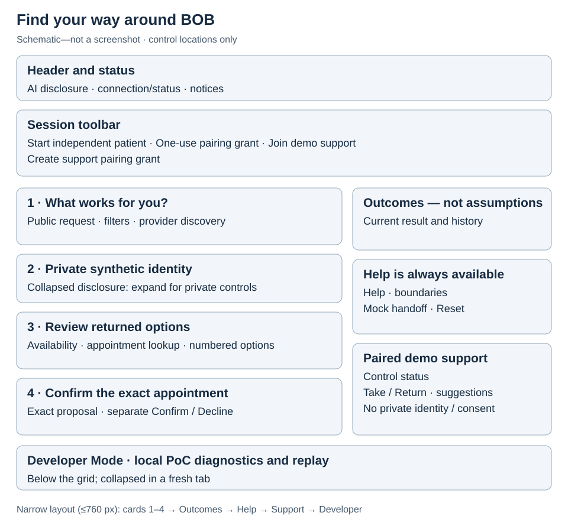
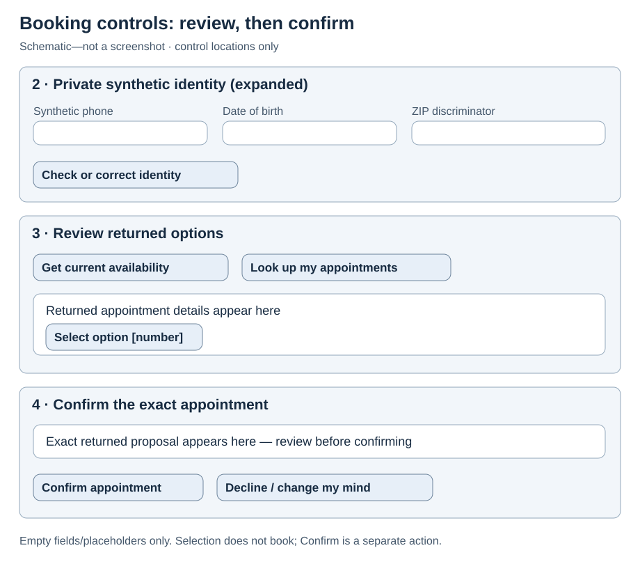
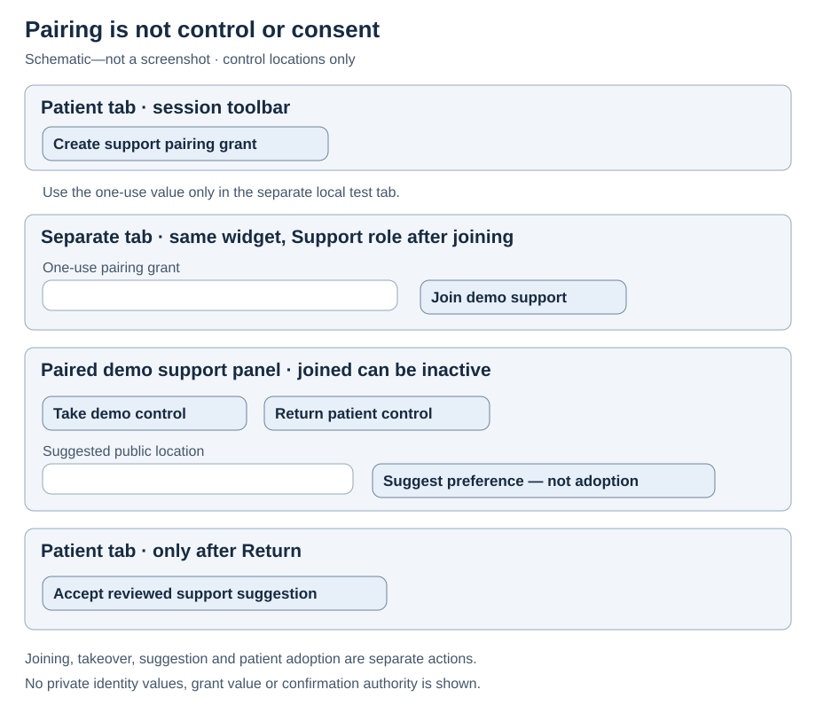
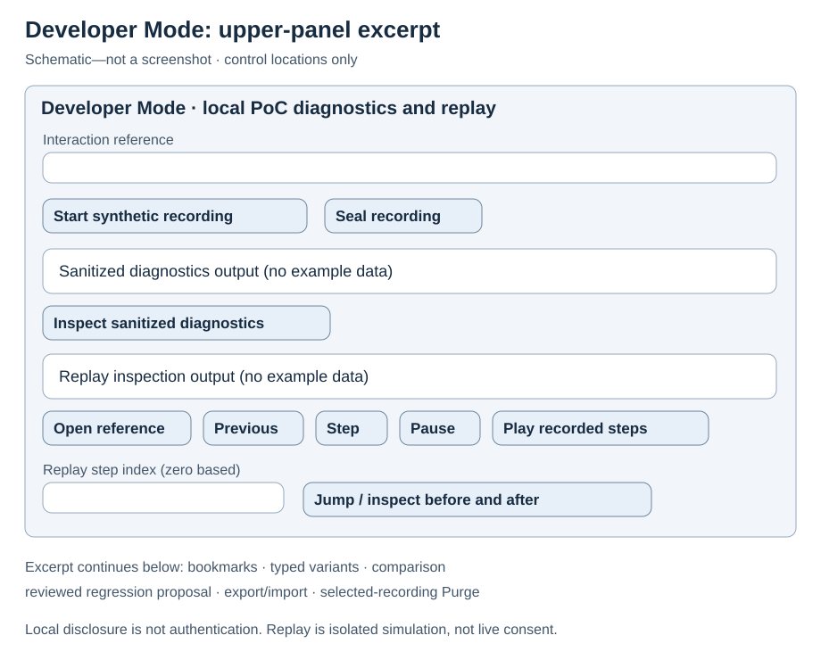

# Scheduling with BOB

Internal-use synthetic demonstration with public source, not a real healthcare service. BOB is AI, not
a clinician or live representative. Follow [setup](../../README.md) with an
explicit Python 3.11+ environment. Offline use needs no model account.

## Find the controls

These drawings are **schematics—not screenshots**. They locate controls in the
shipped widget at source `1c318f3e54508d522b18f57d5bc871c4c04ad9ff`; they show
no patient data, pairing grant or real diagnostic output. Actual buttons wrap
with available width and may be disabled by role/state. Nothing is sticky.

Text locator: header/status → session toolbar → cards 1–4. On desktop, Outcomes,
Help and Paired demo support are alongside those cards. At widths of 760 px or
less, the order is cards 1–4 → Outcomes → Help → Paired demo support → Developer
Mode. Private identity and Developer Mode start collapsed in a fresh tab; local
session storage can restore expansion. This drawing is not mobile/accessibility
qualification.

Jump to [booking](#find-and-confirm-an-appointment), [corrections](#refine-or-correct-the-search),
[lookup](#look-up-existing-appointments), [recovery](#recover-or-request-assistance),
[Support](#support-view) or [Developer replay](#developer-view-and-replay).

## Find and confirm an appointment

Start an independent patient session. Choose specialty/location, select **Find
providers**, then choose a returned provider. In **Private synthetic identity**,
enter `555-0101`, `1985-04-12`, `70112` and select **Check or correct identity**.
Select **Get current availability**, choose a numbered option and review its exact
time, provider and location. Select **Confirm appointment** separately to attempt
the mock booking. Selection alone does not book; no email is required.

Schematic—not a screenshot. Text locator: expand card 2 for the three private
fields and **Check or correct identity**. Card 3 contains availability, lookup
and returned **Select option** buttons. Card 4 holds the exact proposal and
separate Confirm/Decline controls; a returned choice is not consent.

## Refine or correct the search

Change specialty, location or dates and select **Apply preferences**. Review
**Active filters**, then request current availability again. Blank a date control
to clear it; choose **Any location** to remove that filter. The public request box
also accepts offline `provider 1`, `clear provider` and `clear dates`. A spelling
suggestion requires explicit acceptance; it is never silently selected.

Correct private details with **Check or correct identity**. Blank private fields
retain prior local entries; verified inputs clear from the browser. Identity
changes revoke old private results and proposals. **Decline / change my mind**
clears the pending proposal, not an earlier booking. Request fresh options and
review a new proposal before confirming after a correction or decline.
Keep names, phone, DOB and ZIP out of the public request box; use private controls.

## Look up existing appointments

Check the current synthetic identity, then select **Look up my appointments**.
Returned appointments appear in the options area. They are different from
**Outcomes**, the history of booking/handoff attempts. Correcting identity clears
the old private results before another lookup.

## Recover or request assistance

No providers/availability means refine the search or use **Help**. No identity
match means correct private details; multiple matches require ZIP without exposing
candidate records. Empty appointment lookup differs from failed lookup. For a
failed read, follow the message and retry the read when appropriate. For an
**unknown write outcome**, do not repeat the write: follow [recovery](recovery.md).
Reset retains unresolved effect protection.

**Help**, **Medical boundary** and **Unsupported request** remain reachable.
Deliberately select **Submit mock handoff** if wanted. A queued result is a
validated mock receipt, not contact with a person. See the [demo runbook](../internal/demo.md).

## Support view

In the patient toolbar select **Create support pairing grant**. In a separate
local tab of the same widget, enter that one-use value in **One-use pairing
grant** and select **Join demo support**. This changes the role, not the URL. The participant can remain
**joined** while the **control lease is inactive**. Takeover requires a fresh
patient acknowledgement at the current revision, less than five seconds old,
and expires after five minutes; Return ends control,
not pairing. Support cannot fill private identity, request availability or appointment
lookup, select a booking, Confirm or submit a handoff.
An unaccepted suggestion changes nothing. After Return the patient must choose
to accept it, then get current options and freshly select/confirm.

Schematic—not a screenshot. Text locator: join controls are in the toolbar;
**Take demo control**, **Return patient control**, the public-location field and
**Suggest preference — not adoption** are in **Paired demo support**. Joining
is not takeover. **Accept reviewed support suggestion** belongs to the patient
and is available only after control returns; private fields are not mirrored.

## Developer view and replay

Inspect sanitized diagnostics with recording OFF; an owned OFF reference opens
bounded **current sanitized diagnostics**, explicitly not a historical state,
exact recording or full replay. The reference is session-scoped, expires and does
not grant another patient access. It cannot be stepped, forked or exactly exported.
The local Developer disclosure is not production authentication.

Schematic—not a screenshot. Text locator: expand **Developer Mode** below the
main grid. **Interaction reference** precedes recording controls; sanitized
diagnostics precede Replay inspection/navigation. **Replay step index (zero
based)** and **Jump / inspect before and after** follow Previous/Step/Pause/Play.
The panel continues below this excerpt with bookmarks, variants, comparison,
reviewed regression proposals, export/import and selected-recording Purge.

Record only explicitly approved synthetic sessions. Start capture before the
journey, then Seal and inspect fidelity/missing evidence. Open the resulting
reference; step or Jump to a valid event index, use bookmarks, and inspect
sanitized diagnostics. A reference is a locator, not an access capability.
Complete matching recordings can show core semantic parity; browser-renderer
parity remains false. Replay/forks never perform live booking or model calls.

Typed variants are counterfactual experiments, not historical results. Review
the regression-fixture proposal and provenance manually; generated proposals
are simulation-only and are not automatically executed or adopted as tests.
Export/import accepts bounded reviewed data, never executable instructions or
live consent. Use Purge only for a disposable recording: its reference becomes
permanently expired and importing its external export does not revive it.

## Fixed Oct 12 model-budget window

Updated 2026-10-12 for the isolated budget candidate; independent review and
protected integration remain pending in [native tasks](../../specs/001-ochsner-scheduling-assistant/tasks.md#fixed-day-bob-budget-candidate--2026-10-12).
This is not evidence that an already-running service has the change.

For the separately authorized BOB-only exception, append `--openai --unlimited-today`
to the existing CLI or `scripts/serve_browser.py` invocation. All normal runtime
model/credential gates still apply. The opt-in removes numeric call/dollar ceilings
only from **new reservations** during Oct 12, 2026 in America/Chicago:
`2026-10-12T05:00:00Z` inclusive to `2026-10-13T05:00:00Z` exclusive (midnight Central).
It is not a rolling day, persisted bypass, new ledger or allowance for other projects.
The qualifier has no new override flag in this change.

Without that explicit flag, or outside that window, ordinary 200-call/$20 ceilings
apply. Existing counts, costs and unknown liabilities remain. At expiry a ledger
over either ceiling blocks new calls; valid entries can still reopen, snapshot and
settle. Negative ordinary dollar headroom is reported honestly. Do not truncate,
reset or change paths to restore allowance; older code may reject an over-cap ledger.

Only verified priced models and bounded public inputs/outputs are accepted. Private
file/locking/atomic-write guards and the existing 100,000-byte storage limit remain;
reservation checks leave room for outstanding settlements. No retries, tools,
startup model calls or silent fallback are introduced. Readiness is a read-only,
point-in-time check of the existing canonical ledger, not permission to dispatch;
the model host must reserve durably against that same ledger before each call.
