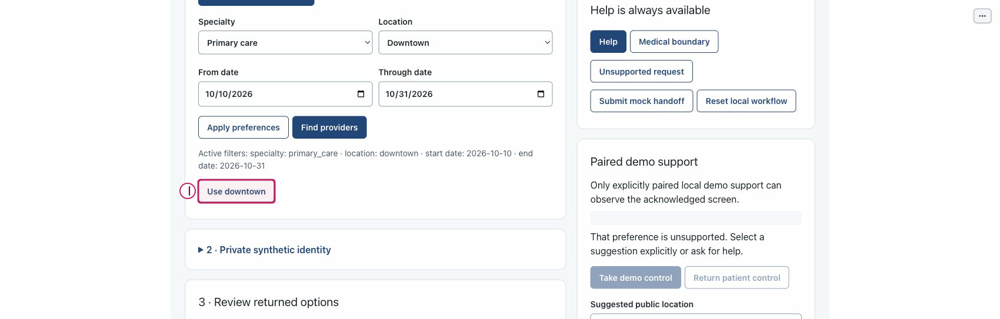
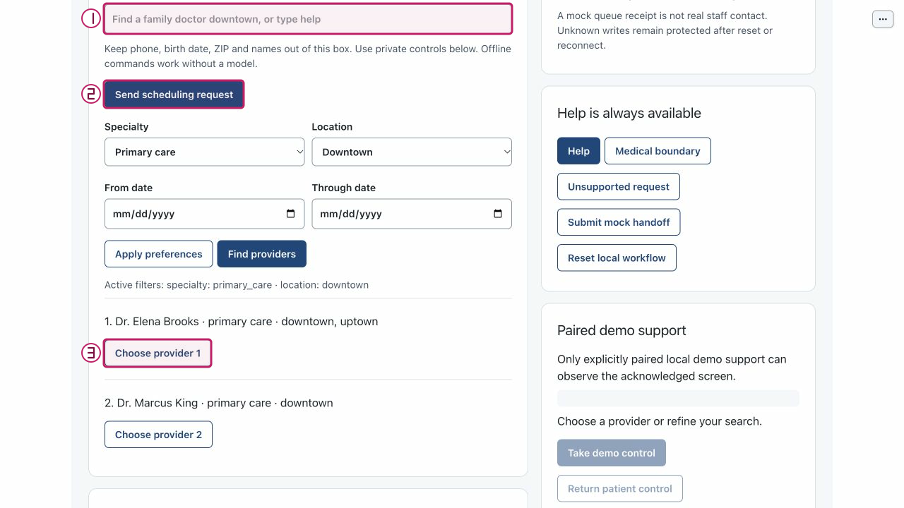

# Review a provider-name spelling suggestion without automatic selection

Purpose: review a provider-name spelling suggestion without automatic selection. Role: patient/reviewer; automated checks use isolated synthetic state.
Scope: US1 / FR-006. Mode: model-first launch available; documented deterministic controls and tests use explicit offline mode.
Limits: fixture matching is not production authentication; mock effects are not care or live staff contact.

## Step 0 — Install and set up

From the repository root, verify an explicit Python 3.11+ interpreter and install:

```sh
python3.11 --version
python3.11 -m venv .venv
.venv/bin/python -m pip install -e .
.venv/bin/python -m pip check
.venv/bin/python tools/poc-runtime/launch.py --doctor
```

If python3.11 is unavailable, use another explicitly verified compatible executable
for both version check and venv creation. Use synthetic fixtures only. Doctor starts
nothing and reads no key. Follow [getting started](../getting-started.md) for the
trusted dedicated-note helper and current runtime/qualification policy; never paste
or save an API key in this document or the app.

## Step 1 — Launch

The normal model-first entrypoint is:

```sh
.venv/bin/python tools/poc-runtime/launch.py
```

Use its printed local app URL. For this document's deterministic no-call control/
test path, explicitly choose the offline alternative instead:

```sh
.venv/bin/python tools/poc-runtime/launch.py --offline --ui-port 29580 --transport-port 29581
```

Use those ports only when free; a conflict is not permission to stop another
process. Ctrl-C stops only this launch's owned children. Test commands below create
their own disposable state and do not require a real model/key or the running UI.

## Arrange the workspace

Put this rendered Markdown on the left and BOB on the right. In Chrome use the
tab menu's New split view/Add tab controls, then Swap sides if needed. If Split
View is unavailable, use side-by-side windows, without extensions or experimental
flags. See [official Chrome guidance](https://support.google.com/chrome/answer/16971124?hl=en).

## Synthetic sample data

1. Public test-only typo: `Dr. Elna Brooks`; canonical returned provider: Dr. Elena Brooks.
2. Test starting provider filter: `prov_2002`; reviewed suggestion value: `prov_2001`.

## Step 2 — Start an independent patient

<!-- walkthrough-step: {"number":2,"interactive":true,"visual_ids":["toolbar-composite"],"control_ids":["start-independent-patient"]} -->

In BOB's toolbar select Start independent patient once and wait for the current
patient view. Expected: Patient role with an initial revision and enabled
scheduling controls; no verified identity, current proposal, booking or handoff.
This creates local synthetic workflow state, not a transaction or Support join.
Recovery: if the page stays uninitialized or reports a connection error, stop
before the next step and check your own launch. Do not reuse another patient's
capability, copy a pairing grant, or restart an Operator session.


## Step 3 — Locate the explicit suggestion family

<!-- walkthrough-step: {"number":3,"interactive":true,"visual_ids":["public-spelling-composite"],"control_ids":["spelling-suggestion"]} -->

Inspect card 1's suggestion area when a public spelling suggestion is actually present. The historical figure shows `Use downtown`, not a freshly executed provider-name suggestion. A `Use {value}` button is explicit adoption, never an automatic provider selection. Do not enter a patient name into public text.



## Step 4 — Run the exact provider-name boundary

<!-- walkthrough-step: {"number":4,"interactive":false,"visual_ids":["public-request-and-provider-composite"],"control_ids":[]} -->

The current deterministic text grammar accepts `provider NUMBER`, not a free-form provider name, and the bounded model action excludes provider_id. There is no documented UI textbox that reliably produces this particular typo case. Run the automated path below instead: it passes provider_id `Dr. Elna Brooks` to the revisioned session, verifies the prior prov_2002 filter stays unchanged, receives a prov_2001 suggestion, explicitly adopts its canonical value, then clears the filter. This is service-contract evidence, not an invented browser button.



## Completion and cleanup

Effect: The automated path changes only reviewed public preferences; no identity or write.

Cleanup: stop only your own launch with Ctrl-C when finished. Leave Operator trials,
canonical accounting, locks and effect namespaces untouched. Reset local workflow
is not erasure of an unresolved write and recording cleanup is not effect recovery.

## Known gaps and evidence

Recovery: inspect the latest response/outcome before another action; obtain fresh
returned options/proposal after invalidation. Never retry an unknown write or
interpret a stale screen as confirmation authority. Provider-name suggestion generation has no reliable current UI entry point. The actual historical spelling-family plate is orientation only; this full browser journey is not verified.

Exact automated path from the repository root:

```sh
PYTHONPATH=src:tests .venv/bin/python -m unittest test_transition_acceptance.TransitionAcceptanceTests.test_provider_name_suggestion_never_selects_or_changes_active_filter -v
```

The runtime source is unchanged from the W2 capture candidate `bdc4585`; checker/
document checkpoints `66da0c8` and `46ddcff` do not add product behavior. Parent's
558-test suite is synthetic service/contract evidence, not proof of this complete
browser journey. Images retain source/hash/mode/unknown-tree/historical limitations
in the [visual manifest](../../../assets/ui/walkthroughs/manifest.json). The visible
2026-10-13 offline booking used returned API time, not a fixed date from a screenshot.
Current support acknowledgement/kernel/reconnect warnings are not hidden.

## Revision history

- 2026-10-14: Corrected the independent-session prerequisite after source-bound
  review; new interactive metadata/toolbar locator do not claim a new browser run.

- 2026-10-14: Drafted from current controls and exact test source; whole-collection
  navigation, independent review and protected integration remain in native tasks.

## References

- [Collection](index.md)
- [Control atlas](../controls/index.md)
- [Native requirements](../../../specs/001-ochsner-scheduling-assistant/spec.md)
- [Exact automated source](../../../tests/test_transition_acceptance.py)
- [Native completion ledger](../../../specs/001-ochsner-scheduling-assistant/tasks.md)
