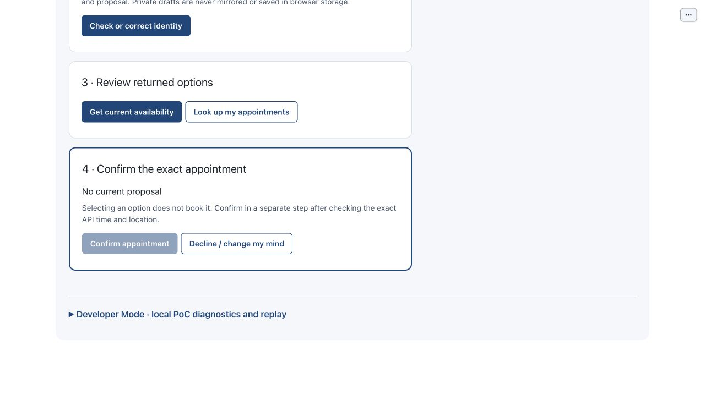

# Consume one confirmation authority only once

Purpose: consume one confirmation authority only once. Role: patient/reviewer; automated checks use isolated synthetic state.
Scope: US1 / FR-009. Mode: model-first launch available; documented deterministic controls and tests use explicit offline mode.
Limits: fixture matching is not production authentication; mock effects are not care or live staff contact.

## Step 0 — Install and set up

From the repository root, verify an explicit Python 3.11+ interpreter and install:

```sh
python3.11 --version
python3.11 -m venv .venv
.venv/bin/python -m pip install -e .
.venv/bin/python -m pip check
.venv/bin/python tools/poc-runtime/launch.py --doctor
```

If python3.11 is unavailable, use another explicitly verified compatible executable
for both version check and venv creation. Use synthetic fixtures only. Doctor starts
nothing and reads no key. Follow [getting started](../getting-started.md) for the
trusted dedicated-note helper and current runtime/qualification policy; never paste
or save an API key in this document or the app.

## Step 1 — Launch

The normal model-first entrypoint is:

```sh
.venv/bin/python tools/poc-runtime/launch.py
```

Use its printed local app URL. For this document's deterministic no-call control/
test path, explicitly choose the offline alternative instead:

```sh
.venv/bin/python tools/poc-runtime/launch.py --offline --ui-port 29580 --transport-port 29581
```

Use those ports only when free; a conflict is not permission to stop another
process. Ctrl-C stops only this launch's owned children. Test commands below create
their own disposable state and do not require a real model/key or the running UI.

## Arrange the workspace

Put this rendered Markdown on the left and BOB on the right. In Chrome use the
tab menu's New split view/Add tab controls, then Swap sides if needed. If Split
View is unavailable, use side-by-side windows, without extensions or experimental
flags. See [official Chrome guidance](https://support.google.com/chrome/answer/16971124?hl=en).

## Synthetic sample data

1. Private controls: standard `555-0101` / `1985-04-12` / `70112`.
2. Use one current returned option; never manufacture a slot, nonce or proposal ID.

## Step 2 — Review and confirm one mock appointment

<!-- walkthrough-step: {"number":2,"interactive":true,"visual_ids":["private-entry-composite","returned-options-and-confirm-composite"],"control_ids":["check-identity","get-availability","select-option","confirm-appointment"]} -->

Enter the standard fixture in private card 2 and Check or correct identity. Choose Primary care/Downtown, Get current availability, Select option and review its exact current API time/location. Click Confirm appointment once. Expected: a validated mock receipt in Outcomes and consumed/disabled repeat confirmation. A completed receipt is not a production appointment.


## Step 3 — Check the consumed state, not a second booking

<!-- walkthrough-step: {"number":3,"interactive":true,"visual_ids":["confirmation-consumed"],"control_ids":["confirm-appointment"]} -->

Read Outcomes and the confirmation state after the response. Do not fetch a new proposal or click another option as a supposed duplicate test—that would be new authority. If the outcome is unknown, do not retry. The deterministic concurrent race is the automated test below; UI timing is not a reliable concurrency harness.



## Step 4 — Run the controlled concurrency contract

<!-- walkthrough-step: {"number":4,"interactive":false,"visual_ids":[],"control_ids":[]} -->

The test submits the same current confirmation snapshot from two threads against the real session/journal and asserts exactly one write. It does not click the browser or use a model.

## Completion and cleanup

Effect: At most one synthetic write for the reviewed single-use confirmation; no repeat dispatch for its consumed authority.

Cleanup: stop only your own launch with Ctrl-C when finished. Leave Operator trials,
canonical accounting, locks and effect namespaces untouched. Reset local workflow
is not erasure of an unresolved write and recording cleanup is not effect recovery.

## Known gaps and evidence

Recovery: inspect the latest response/outcome before another action; obtain fresh
returned options/proposal after invalidation. Never retry an unknown write or
interpret a stale screen as confirmation authority. W2 captured a consumed confirmation after one offline mock booking, not a double-click/race browser qualification. The thread race uses a synthetic port and independent disposable state.

Exact automated path from the repository root:

```sh
PYTHONPATH=src:tests .venv/bin/python -m unittest test_session_contract.SessionContractTests.test_concurrent_confirmation_claims_one_effect -v
```

The runtime source is unchanged from the W2 capture candidate `bdc4585`; checker/
document checkpoints `66da0c8` and `46ddcff` do not add product behavior. Parent's
558-test suite is synthetic service/contract evidence, not proof of this complete
browser journey. Images retain source/hash/mode/unknown-tree/historical limitations
in the [visual manifest](../../../assets/ui/walkthroughs/manifest.json). The visible
2026-10-13 offline booking used returned API time, not a fixed date from a screenshot.
Current support acknowledgement/kernel/reconnect warnings are not hidden.

## Revision history

- 2026-10-14: Drafted from current controls and exact test source; whole-collection
  navigation, independent review and protected integration remain in native tasks.

## References

- [Collection](index.md)
- [Control atlas](../controls/index.md)
- [Native requirements](../../../specs/001-ochsner-scheduling-assistant/spec.md)
- [Exact automated source](../../../tests/test_session_contract.py)
- [Native completion ledger](../../../specs/001-ochsner-scheduling-assistant/tasks.md)
