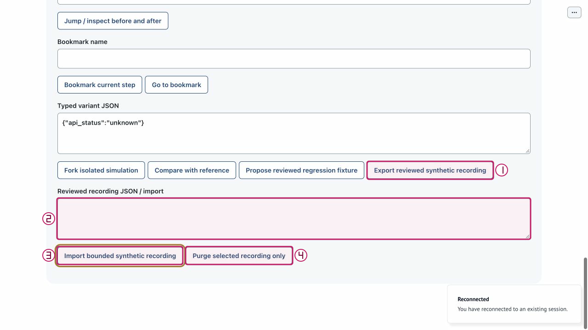

# Review, export and import recording data

Purpose: Move bounded synthetic recording data into a session without treating its digest as authenticity or consent. Role: developer or synthetic-session reviewer.

Scope: US4. Mode: recorded-simulation; capture uses the explicitly chosen launch mode. Limits: synthetic local PoC only; no production authentication, live representative or clinical service. The full journey remains unverified on this documentation candidate.

## Step 0 — Install and set up

From the repository root, verify Python 3.11+ and install into the project environment:

```sh
python3.11 --version
python3.11 -m venv .venv
.venv/bin/python -m pip install -e .
.venv/bin/python -m pip check
.venv/bin/python tools/poc-runtime/launch.py --doctor
```

If `python3.11` is absent, use an explicit compatible executable, for example `/opt/homebrew/bin/python3.12`: verify its `--version` is 3.11+ and use that same executable for `-m venv .venv`. Do not assume `python3` is compatible. Follow [getting started](../getting-started.md) for the trusted exact-note helper and current application runtime policy. Doctor retrieves no key, starts no service and makes no model call.

## Step 1 — Launch

Normal model-first launch:

```sh
.venv/bin/python tools/poc-runtime/launch.py
```

Open the printed local URL. Startup/readiness does not qualify model behavior. A port conflict is an error, not permission to stop another process. Ctrl-C owns only this launch and its children.

For an explicit no-call walkthrough, use the following only if **both ports are free**:

```sh
.venv/bin/python tools/poc-runtime/launch.py --offline --ui-port 29580 --transport-port 29581
```

Do not reuse or stop an existing process on those ports. All supplied W2 capture evidence is offline or dated historical synthetic evidence; it is not genuine new model qualification.

## Arrange the workspace

Keep this rendered Markdown on the left and BOB on the right. In Chrome, open a tab's context menu and use **New split view**, then **Add tab** to select the other tab; use **Swap sides** if needed. See [official Chrome Split View guidance](https://support.google.com/chrome/answer/16971124?hl=en). If unavailable, use side-by-side windows; no extension or experimental flags are needed.

## Synthetic sample data

1. Capture only **Help**, then **Medical boundary** for this small round trip.
2. Payload: the exact reviewed JSON exported by this session; no hand-written recording document.
3. Import limit: 1 MiB of UTF-8; an export can be larger and explicitly not reimportable.
4. Private synthetic phone: `555-0101` in **Synthetic phone** only.
5. Private DOB: `1985-04-12` in **Date of birth** only.
6. Private ZIP: `70112` in **ZIP discriminator** only. These values are optional orientation for flows that do not identify a patient.

Keep names, phone, DOB and ZIP out of the public request box. Only application-owned private identity controls receive those fixture values. Use only your own disposable local session and recording references.

## Step 2 — Start a disposable patient and opt into capture
<!-- walkthrough-step: {"number":2,"interactive":true,"visual_ids":["toolbar-composite","recording-and-diagnostics-composite"],"control_ids":["start-independent-patient","developer-disclosure","start-recording"]} -->

Select **Start independent patient** (`start-independent-patient`), scroll below the main flow and expand **Developer Mode · local PoC diagnostics and replay** (`developer-disclosure`). Select **Start synthetic recording** (`start-recording`) before the sample actions. Expected: explicit synthetic capture is active with a local reference. This disclosure is not authentication. Recovery: if disabled or denied, check patient role, pending work and takeover; do not use a Support role or an Operator session to force capture.


The figure is an existing atlas locator with separate numbered annotations over actual pixels; the action and expected result above are its text equivalent. It is not a newly executed result or a captured failure.

## Step 3 — Capture two safe local actions
<!-- walkthrough-step: {"number":3,"interactive":true,"visual_ids":["help-actions-composite"],"control_ids":["help","medical-boundary"]} -->

Select **Help** (`help`), wait for its visible result, then select **Medical boundary** (`medical-boundary`) and wait again. Expected: help followed by the local medical boundary without advice or a handoff write. Recording begins before both actions; browser acknowledgement failures remain missing evidence. Recovery: inspect the actual message after reconnect and do not infer that an unobserved action occurred. Never select Submit mock handoff as part of this sample.


The figure is an existing atlas locator with separate numbered annotations over actual pixels; the action and expected result above are its text equivalent. It is not a newly executed result or a captured failure.

## Step 4 — Seal and open the owned recorded reference
<!-- walkthrough-step: {"number":4,"interactive":true,"visual_ids":["recording-and-diagnostics-composite","replay-basic-composite"],"control_ids":["seal-recording","interaction-reference","open-reference"]} -->

Select **Seal recording** (`seal-recording`). Review its reference, recording status, missing fields, dropped count and stored flag. Keep the returned reference in **Interaction reference** (`interaction-reference`) and select **Open reference** (`open-reference`). Expected: an owned recorded-only simulation starting at index -1, with event_count and fidelity disclosed. `incomplete_capture` may still permit bounded semantic inspection; it never becomes full browser evidence. Recovery: if storage is unavailable or the reference is expired/not granted, preserve the report and capture a new disposable session if appropriate. OFF diagnostics cannot substitute for an exact recording.


The figure is an existing atlas locator with separate numbered annotations over actual pixels; the action and expected result above are its text equivalent. It is not a newly executed result or a captured failure.

## Step 5 — Review the selected recording before export
<!-- walkthrough-step: {"number":5,"interactive":true,"visual_ids":["recording-and-diagnostics-composite"],"control_ids":["inspect-diagnostics"]} -->

Select **Inspect sanitized diagnostics** (`inspect-diagnostics`) and review the capture summary. Verify this is your disposable synthetic recording and its completeness/ownership are understood. Expected: truthful missing/dropped/storage information, not authenticity certification. Recovery: if not your selected recording, reopen the intended owned reference; do not export someone else's data.


The figure is an existing atlas locator with separate numbered annotations over actual pixels; the action and expected result above are its text equivalent. It is not a newly executed result or a captured failure.

## Step 6 — Export the reviewed synthetic payload
<!-- walkthrough-step: {"number":6,"interactive":true,"visual_ids":["recording-data-actions-composite"],"control_ids":["export-recording","recording-json"]} -->

After reviewing the intended recording, select **Export reviewed synthetic recording** (`export-recording`). Read **Reviewed recording JSON / import** (`recording-json`). Expected: exact data payload, export_bytes, import_limit_bytes and reimportable flag in Replay inspection. Review the payload for synthetic-only content and provenance before any sharing. Recovery: unavailable/expired storage provides no payload; do not use a cached export as evidence of current availability or truncate an oversized export.



The figure is an existing atlas locator with separate numbered annotations over actual pixels; the action and expected result above are its text equivalent. It is not a newly executed result or a captured failure.

## Step 7 — Import the reviewed unmodified payload
<!-- walkthrough-step: {"number":7,"interactive":true,"visual_ids":["recording-data-actions-composite"],"control_ids":["recording-json","import-recording"]} -->

Keep the small unmodified reviewed payload in **Reviewed recording JSON / import** (`recording-json`) and select **Import bounded synthetic recording** (`import-recording`). Expected: caller-session-scoped simulation, index -1, original provenance/completeness preserved and no live patient revision or consent transferred. An already stored identical recording may be reused idempotently. Recovery: invalid/schema/digest/fixture/size rejection must not be bypassed by editing authority fields or reducing safeguards. Import accepts data, not a trusted author or real authentication.


The figure is an existing atlas locator with separate numbered annotations over actual pixels; the action and expected result above are its text equivalent. It is not a newly executed result or a captured failure.

## Completion and cleanup

Effect: Capture and review change only private bounded diagnostic/recording state; sample Help/Medical actions do not book or contact staff. No real care or delivery. Replay and comparison confer no live consent or authority. If any earlier live write has unknown outcome, do not retry it; reconcile separately.

Cleanup: Close only your own demonstration tabs. If replay is playing, select Pause before leaving. Stop only your own launch with Ctrl-C; never stop an existing Operator process, purge an Operator recording, or erase capability, accounting or effect state.

## Known gaps and evidence

Recovery: W2 located export/import controls; it did not demonstrate this complete round trip. A matching digest establishes content identity only. Missing core/browser evidence remains incomplete after import; foreign references and expired tombstones are not revived. If reconnect clears diagnostics or resets the replay index, inspect current state, reopen your owned reference if available and re-enter a valid bounded index. A queued action or click is not proof that the intended transition happened.

Source basis: application/atlas source `bdc4585` and parent checker checkpoint `66da0c8`, with later docs-only changes. Support originals retain `c3e6df2` / `e2dfa7e` where used: their unchanged control constructors are applicable, but the older membership label is not evidence of repaired status. Current IAB joined/inactive and acknowledgement-unavailable observations are not fresh successful synchronization.

The W2 atlas supplies historical/offline actual control observations only; this document adds no browser execution evidence. Test methods below describe existing automated contracts, not newly run tests:

```sh
PYTHONPATH=src:tests .venv/bin/python -m unittest test_replay_contract.ReplayContractTests.test_recording_roundtrip_keeps_exact_approved_inputs_and_provenance -v
PYTHONPATH=src:tests .venv/bin/python -m unittest test_interaction_service.InteractionServiceTests.test_import_grants_only_the_callers_session_without_any_live_calls_or_revision -v
PYTHONPATH=src:tests .venv/bin/python -m unittest test_interaction_service.InteractionServiceTests.test_export_requires_literal_review_and_current_authorized_valid_storage -v
```

Not run by this document worker: setup/install/doctor, app launch, browser actions, fault injection, model calls, destructive purge, demos or the full suite. Parent owns combined verification and final integration. Structural coverage is not browser certification; no mobile, accessibility, renderer-parity or genuine new model qualification is claimed.

## Revision history

- 2026-10-14: Drafted from exact sources and supplied atlas evidence; parent final QA/integration pending. Native tasks remain the sole progress ledger.

## References

- [Native specification](../../../specs/001-ochsner-scheduling-assistant/spec.md) · [plan](../../../specs/001-ochsner-scheduling-assistant/plan.md) · [native tasks](../../../specs/001-ochsner-scheduling-assistant/tasks.md).
- [Control atlas](../controls/replay-variants-and-data.md) · [all control groups](../controls/index.md).
- [Visual manifest and evidence limitations](../../../assets/ui/walkthroughs/manifest.json) · [historical still provenance](../../../assets/ui/stills/feature-completion-20261010/manifest.json).
- [Runtime and exact-note helper guidance](../getting-started.md) · [recovery](../recovery.md).
- [tests/test_replay_contract.py](../../../tests/test_replay_contract.py).
- [tests/test_interaction_service.py](../../../tests/test_interaction_service.py).
- [src/ochsner_bob/interaction_service.py](../../../src/ochsner_bob/interaction_service.py).
- [src/ochsner_bob/replay.py](../../../src/ochsner_bob/replay.py).
- [src/ochsner_bob/widget.js](../../../src/ochsner_bob/widget.js).
