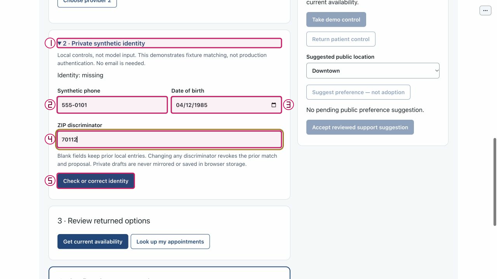

# Keep independent patient sessions isolated

Purpose: Verify that starting another patient creates a separate namespace rather than sharing the first identity. Role: patient and local demo Support reviewer.

Scope: US5 / FR-017 / tests/test_browser_service.py. Mode: offline control exercise; normal launch is model-first. Limits: synthetic local PoC only; no production authentication, live representative or clinical service. The full journey remains unverified on this documentation candidate.

## Step 0 — Install and set up

From the repository root, verify Python 3.11+ and install into the project environment:

```sh
python3.11 --version
python3.11 -m venv .venv
.venv/bin/python -m pip install -e .
.venv/bin/python -m pip check
.venv/bin/python tools/poc-runtime/launch.py --doctor
```

If `python3.11` is absent, use an explicit compatible executable, for example `/opt/homebrew/bin/python3.12`: verify its `--version` is 3.11+ and use that same executable for `-m venv .venv`. Do not assume `python3` is compatible. Follow [getting started](../getting-started.md) for the trusted exact-note helper and current application runtime policy. Doctor retrieves no key, starts no service and makes no model call.

## Step 1 — Launch

Normal model-first launch:

```sh
.venv/bin/python tools/poc-runtime/launch.py
```

Open the printed local URL. Startup/readiness does not qualify model behavior. A port conflict is an error, not permission to stop another process. Ctrl-C owns only this launch and its children.

For an explicit no-call walkthrough, use the following only if **both ports are free**:

```sh
.venv/bin/python tools/poc-runtime/launch.py --offline --ui-port 29580 --transport-port 29581
```

Do not reuse or stop an existing process on those ports. All supplied W2 capture evidence is offline or dated historical synthetic evidence; it is not genuine new model qualification.

## Arrange the workspace

Keep this rendered Markdown on the left and BOB on the right. In Chrome, open a tab's context menu and use **New split view**, then **Add tab** to select the other tab; use **Swap sides** if needed. See [official Chrome Split View guidance](https://support.google.com/chrome/answer/16971124?hl=en). If unavailable, use side-by-side windows; no extension or experimental flags are needed.

## Synthetic sample data

1. Patient A and patient B are separate tabs, each using Start independent patient.
2. Patient A private fixture: phone `555-0101`, DOB `1985-04-12`, ZIP `70112`; patient B leaves private fields empty.
3. Private synthetic phone: `555-0101` in **Synthetic phone** only.
4. Private DOB: `1985-04-12` in **Date of birth** only.
5. Private ZIP: `70112` in **ZIP discriminator** only. These values are optional orientation for flows that do not identify a patient.

Keep names, phone, DOB and ZIP out of the public request box. Only application-owned private identity controls receive those fixture values. Use only your own disposable local session and recording references.

## Step 2 — Start two explicitly independent patients
<!-- walkthrough-step: {"number":2,"interactive":true,"visual_ids":["toolbar-composite"],"control_ids":["start-independent-patient"]} -->

Open the printed URL in two tabs. In each tab select **Start independent patient** (`start-independent-patient`) once; label your tabs A and B mentally. Expected: separate session/revision state. Recovery: if a duplicated tab restored a capability, explicitly use Start independent patient in that tab. This does not delete the previous session or its unknown-effect protection.


The figure is an existing atlas locator with separate numbered annotations over actual pixels; the action and expected result above are its text equivalent. It is not a newly executed result or a captured failure.

## Step 3 — Identify only patient A
<!-- walkthrough-step: {"number":3,"interactive":true,"visual_ids":["private-entry-composite"],"control_ids":["private-disclosure","synthetic-phone","date-of-birth","zip-discriminator","check-identity"]} -->

In A expand **2 · Private synthetic identity** (`private-disclosure`); enter the sample phone, DOB and ZIP in `synthetic-phone`, `date-of-birth`, `zip-discriminator`, then select **Check or correct identity** (`check-identity`). Expected: A verifies the supplied fixture and the browser inputs clear. B must still show missing identity; do not type identity into the public request. Recovery: correct private fields in A only if needed; never transfer A's private result to B.



The figure is an existing atlas locator with separate numbered annotations over actual pixels; the action and expected result above are its text equivalent. It is not a newly executed result or a captured failure.

## Step 4 — Compare safe local state and the automated isolation contract
<!-- walkthrough-step: {"number":4,"interactive":true,"visual_ids":["help-actions-composite"],"control_ids":["help"]} -->

In B select **Help** (`help`) and inspect both sessions. Expected: B's help state does not become A's workflow; B's identity remains missing. Polling/rendering alone does not issue booking/handoff writes. Recovery: if both tabs show the same session, use Start independent patient in the intended independent tab and review again, preserving the old session. The exact test below asserts separate identity and zero writes; visual comparison alone is not exhaustive isolation proof.


The figure is an existing atlas locator with separate numbered annotations over actual pixels; the action and expected result above are its text equivalent. It is not a newly executed result or a captured failure.

## Completion and cleanup

Effect: Local pairing, lease and public preference state only. No booking, mock handoff, real staff contact or care is performed. Replay and comparison confer no live consent or authority. If any earlier live write has unknown outcome, do not retry it; reconcile separately.

Cleanup: Close only your own demonstration tabs. If replay is playing, select Pause before leaving. Stop only your own launch with Ctrl-C; never stop an existing Operator process, purge an Operator recording, or erase capability, accounting or effect state.

## Known gaps and evidence

Recovery: Service tests prove bounded contracts, not complete browser isolation/security certification. No new two-session browser journey ran during drafting. If reconnect clears diagnostics or resets the replay index, inspect current state, reopen your owned reference if available and re-enter a valid bounded index. A queued action or click is not proof that the intended transition happened.

Source basis: application/atlas source `bdc4585` and parent checker checkpoint `66da0c8`, with later docs-only changes. Support originals retain `c3e6df2` / `e2dfa7e` where used: their unchanged control constructors are applicable, but the older membership label is not evidence of repaired status. Current IAB joined/inactive and acknowledgement-unavailable observations are not fresh successful synchronization.

The W2 atlas supplies historical/offline actual control observations only; this document adds no browser execution evidence. Test methods below describe existing automated contracts, not newly run tests:

```sh
PYTHONPATH=src:tests .venv/bin/python -m unittest test_browser_service.BrowserServiceTests.test_two_sessions_and_polling_do_not_share_or_execute -v
PYTHONPATH=src:tests .venv/bin/python -m unittest test_interaction_service.InteractionServiceTests.test_support_and_other_sessions_cannot_capture_or_access_foreign_references -v
```

Not run by this document worker: setup/install/doctor, app launch, browser actions, fault injection, model calls, destructive purge, demos or the full suite. Parent owns combined verification and final integration. Structural coverage is not browser certification; no mobile, accessibility, renderer-parity or genuine new model qualification is claimed.

## Revision history

- 2026-10-14: Drafted from exact sources and supplied atlas evidence; parent final QA/integration pending. Native tasks remain the sole progress ledger.

## References

- [Native specification](../../../specs/001-ochsner-scheduling-assistant/spec.md) · [plan](../../../specs/001-ochsner-scheduling-assistant/plan.md) · [native tasks](../../../specs/001-ochsner-scheduling-assistant/tasks.md).
- [Control atlas](../controls/support.md) · [all control groups](../controls/index.md).
- [Visual manifest and evidence limitations](../../../assets/ui/walkthroughs/manifest.json) · [historical still provenance](../../../assets/ui/stills/feature-completion-20261010/manifest.json).
- [Runtime and exact-note helper guidance](../getting-started.md) · [recovery](../recovery.md).
- [tests/test_browser_service.py](../../../tests/test_browser_service.py).
- [tests/test_interaction_service.py](../../../tests/test_interaction_service.py).
- [src/ochsner_bob/browser_service.py](../../../src/ochsner_bob/browser_service.py).
- [src/ochsner_bob/widget.js](../../../src/ochsner_bob/widget.js).
