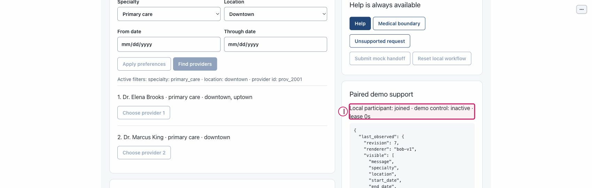

# Recover from an expired one-use pairing grant

Purpose: Reject stale pairing data and join using a separately generated current grant. Role: patient and local demo Support reviewer.

Scope: US5 / FR-017 / tests/test_browser_service.py. Mode: offline control exercise; normal launch is model-first. Limits: synthetic local PoC only; no production authentication, live representative or clinical service. The full journey remains unverified on this documentation candidate.

## Step 0 — Install and set up

From the repository root, verify Python 3.11+ and install into the project environment:

```sh
python3.11 --version
python3.11 -m venv .venv
.venv/bin/python -m pip install -e .
.venv/bin/python -m pip check
.venv/bin/python tools/poc-runtime/launch.py --doctor
```

If `python3.11` is absent, use an explicit compatible executable, for example `/opt/homebrew/bin/python3.12`: verify its `--version` is 3.11+ and use that same executable for `-m venv .venv`. Do not assume `python3` is compatible. Follow [getting started](../getting-started.md) for the trusted exact-note helper and current application runtime policy. Doctor retrieves no key, starts no service and makes no model call.

## Step 1 — Launch

Normal model-first launch:

```sh
.venv/bin/python tools/poc-runtime/launch.py
```

Open the printed local URL. Startup/readiness does not qualify model behavior. A port conflict is an error, not permission to stop another process. Ctrl-C owns only this launch and its children.

For an explicit no-call walkthrough, use the following only if **both ports are free**:

```sh
.venv/bin/python tools/poc-runtime/launch.py --offline --ui-port 29580 --transport-port 29581
```

Do not reuse or stop an existing process on those ports. All supplied W2 capture evidence is offline or dated historical synthetic evidence; it is not genuine new model qualification.

## Arrange the workspace

Keep this rendered Markdown on the left and BOB on the right. In Chrome, open a tab's context menu and use **New split view**, then **Add tab** to select the other tab; use **Swap sides** if needed. See [official Chrome Split View guidance](https://support.google.com/chrome/answer/16971124?hl=en). If unavailable, use side-by-side windows; no extension or experimental flags are needed.

## Synthetic sample data

1. Grant TTL: 300 seconds from creation; consumption is one-use.
2. Use the patient's newly generated replacement value privately; never fabricate a grant.
3. Private synthetic phone: `555-0101` in **Synthetic phone** only.
4. Private DOB: `1985-04-12` in **Date of birth** only.
5. Private ZIP: `70112` in **ZIP discriminator** only. These values are optional orientation for flows that do not identify a patient.

Keep names, phone, DOB and ZIP out of the public request box. Only application-owned private identity controls receive those fixture values. Use only your own disposable local session and recording references.

## Step 2 — Start the patient and open the local support workspace
<!-- walkthrough-step: {"number":2,"interactive":true,"visual_ids":["toolbar-composite"],"control_ids":["start-independent-patient"]} -->

Select **Start independent patient** (`start-independent-patient`) in a tab opened at the printed URL. Keep this patient tab open; open the same URL in a separate tab for Support. Expected: a new patient session, not reconnection to an old patient's effects. Recovery: if no patient state appears, check the launch connection and refresh; do not reset or reuse another person's session.


The figure is an existing atlas locator with separate numbered annotations over actual pixels; the action and expected result above are its text equivalent. It is not a newly executed result or a captured failure.

## Step 3 — Generate a grant and let it expire
<!-- walkthrough-step: {"number":3,"interactive":true,"visual_ids":["toolbar-composite"],"control_ids":["create-pairing"]} -->

Select **Create support pairing grant** (`create-pairing`), keep the value private, and leave it unconsumed for at least 300 seconds. Expected contract: the old value expires; waiting does not grant access. Recovery: if elapsed time is uncertain, treat the value as unusable and create a new one. The figure locates the toolbar; it does not capture expiry.


The figure is an existing atlas locator with separate numbered annotations over actual pixels; the action and expected result above are its text equivalent. It is not a newly executed result or a captured failure.

## Step 4 — Observe rejection and join with a fresh grant
<!-- walkthrough-step: {"number":4,"interactive":true,"visual_ids":["toolbar-composite"],"control_ids":["pairing-grant","join-support","create-pairing"]} -->

In the second tab enter the expired value in **One-use pairing grant** (`pairing-grant`) and select **Join demo support** (`join-support`). Expected: invalid/expired/already-used denial, not access. Then create a fresh grant in the original current patient tab, replace the field and join once. Expected: joined/inactive Support, subject to acknowledgement freshness. Recovery: expired patient capability requires a new independent patient session; restarting is not renewal and must not erase unknown effects.


The figure is an existing atlas locator with separate numbered annotations over actual pixels; the action and expected result above are its text equivalent. It is not a newly executed result or a captured failure.

## Step 5 — Check expiry boundaries without waiting in a browser
<!-- walkthrough-step: {"number":5,"interactive":false,"visual_ids":["support-joined-state-composite"],"control_ids":[]} -->

Automated-only deterministic boundary: the cited test fills the outstanding grant cap, advances its disposable clock to 300 seconds, rejects an old grant, joins a fresh one, rejects reuse and rejects a pre-restart outstanding grant. No UI clock override exists. Expected: one-use and expiry remain enforced. Recovery: replace the grant; do not reset capability/effect state. Historical joined state is orientation only.

Executable test contract (not run for this document):

```sh
PYTHONPATH=src:tests .venv/bin/python -m unittest test_browser_service.BrowserServiceTests.test_pairing_cap_expiry_and_restart_keep_grants_one_use -v
PYTHONPATH=src:tests .venv/bin/python -m unittest test_browser_service.BrowserServiceTests.test_patient_expiry_also_invalidates_unconsumed_pairing -v
```



The figure is an existing atlas locator with separate numbered annotations over actual pixels; the action and expected result above are its text equivalent. It is not a newly executed result or a captured failure.

## Completion and cleanup

Effect: Local pairing, lease and public preference state only. No booking, mock handoff, real staff contact or care is performed. Replay and comparison confer no live consent or authority. If any earlier live write has unknown outcome, do not retry it; reconcile separately.

Cleanup: Close only your own demonstration tabs. If replay is playing, select Pause before leaving. Stop only your own launch with Ctrl-C; never stop an existing Operator process, purge an Operator recording, or erase capability, accounting or effect state.

## Known gaps and evidence

Recovery: The manual elapsed-time route is documented, not newly executed. Tests control disposable clocks; do not alter the operating-system clock or restart an Operator process to manufacture expiry. If reconnect clears diagnostics or resets the replay index, inspect current state, reopen your owned reference if available and re-enter a valid bounded index. A queued action or click is not proof that the intended transition happened.

Source basis: application/atlas source `bdc4585` and parent checker checkpoint `66da0c8`, with later docs-only changes. Support originals retain `c3e6df2` / `e2dfa7e` where used: their unchanged control constructors are applicable, but the older membership label is not evidence of repaired status. Current IAB joined/inactive and acknowledgement-unavailable observations are not fresh successful synchronization.

The W2 atlas supplies historical/offline actual control observations only; this document adds no browser execution evidence. Test methods below describe existing automated contracts, not newly run tests:

```sh
PYTHONPATH=src:tests .venv/bin/python -m unittest test_browser_service.BrowserServiceTests.test_pairing_cap_expiry_and_restart_keep_grants_one_use -v
PYTHONPATH=src:tests .venv/bin/python -m unittest test_browser_service.BrowserServiceTests.test_patient_expiry_also_invalidates_unconsumed_pairing -v
```

Not run by this document worker: setup/install/doctor, app launch, browser actions, fault injection, model calls, destructive purge, demos or the full suite. Parent owns combined verification and final integration. Structural coverage is not browser certification; no mobile, accessibility, renderer-parity or genuine new model qualification is claimed.

## Revision history

- 2026-10-14: Drafted from exact sources and supplied atlas evidence; parent final QA/integration pending. Native tasks remain the sole progress ledger.

## References

- [Native specification](../../../specs/001-ochsner-scheduling-assistant/spec.md) · [plan](../../../specs/001-ochsner-scheduling-assistant/plan.md) · [native tasks](../../../specs/001-ochsner-scheduling-assistant/tasks.md).
- [Control atlas](../controls/support.md) · [all control groups](../controls/index.md).
- [Visual manifest and evidence limitations](../../../assets/ui/walkthroughs/manifest.json) · [historical still provenance](../../../assets/ui/stills/feature-completion-20261010/manifest.json).
- [Runtime and exact-note helper guidance](../getting-started.md) · [recovery](../recovery.md).
- [tests/test_browser_service.py](../../../tests/test_browser_service.py).
- [src/ochsner_bob/browser_service.py](../../../src/ochsner_bob/browser_service.py).
- [src/ochsner_bob/widget.js](../../../src/ochsner_bob/widget.js).
