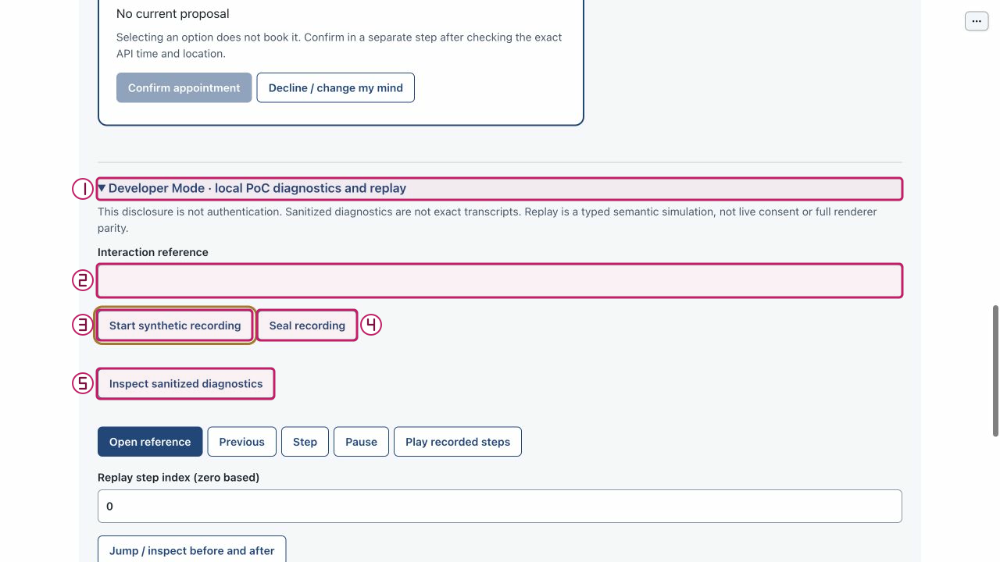
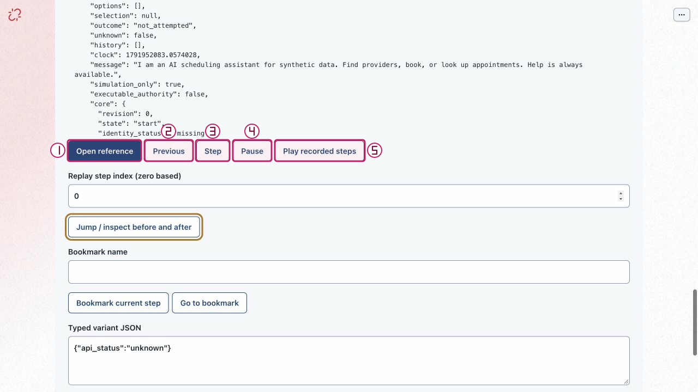
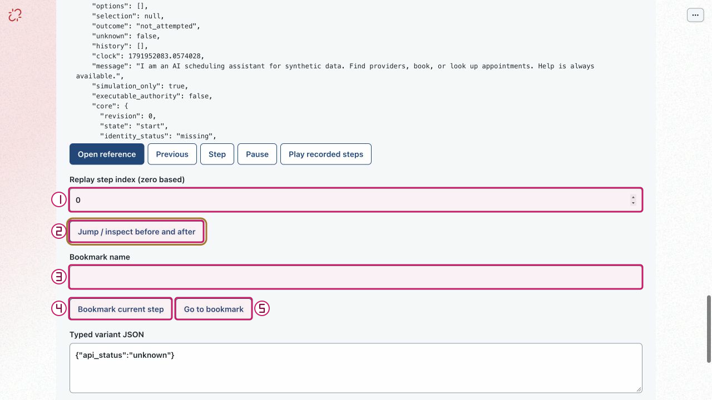
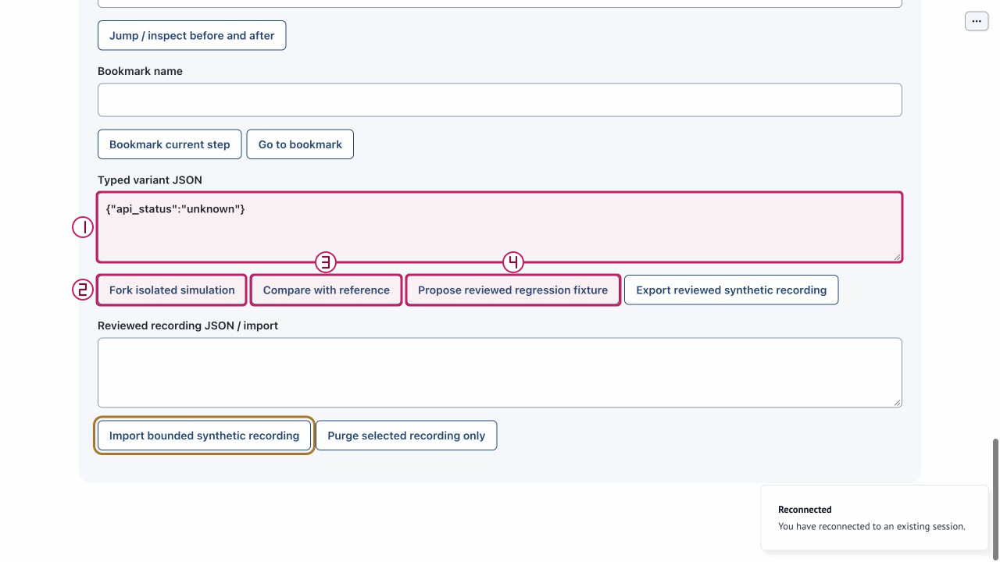

# Review a recorded model-timeout variant

Purpose: Replace a recorded model outcome with timeout without issuing a new model request. Role: developer or regression reviewer.

Scope: US4 / FR-015 / tests/test_replay_contract.py. Mode: recorded-simulation; no live effects in forks. Limits: synthetic local PoC only; no production authentication, live representative or clinical service. The full journey remains unverified on this documentation candidate.

## Step 0 — Install and set up

From the repository root, verify Python 3.11+ and install into the project environment:

```sh
python3.11 --version
python3.11 -m venv .venv
.venv/bin/python -m pip install -e .
.venv/bin/python -m pip check
.venv/bin/python tools/poc-runtime/launch.py --doctor
```

If `python3.11` is absent, use an explicit compatible executable, for example `/opt/homebrew/bin/python3.12`: verify its `--version` is 3.11+ and use that same executable for `-m venv .venv`. Do not assume `python3` is compatible. Follow [getting started](../getting-started.md) for the trusted exact-note helper and current application runtime policy. Doctor retrieves no key, starts no service and makes no model call.

## Step 1 — Launch

Normal model-first launch:

```sh
.venv/bin/python tools/poc-runtime/launch.py
```

Open the printed local URL. Startup/readiness does not qualify model behavior. A port conflict is an error, not permission to stop another process. Ctrl-C owns only this launch and its children.

For an explicit no-call walkthrough, use the following only if **both ports are free**:

```sh
.venv/bin/python tools/poc-runtime/launch.py --offline --ui-port 29580 --transport-port 29581
```

Do not reuse or stop an existing process on those ports. All supplied W2 capture evidence is offline or dated historical synthetic evidence; it is not genuine new model qualification.

## Arrange the workspace

Keep this rendered Markdown on the left and BOB on the right. In Chrome, open a tab's context menu and use **New split view**, then **Add tab** to select the other tab; use **Swap sides** if needed. See [official Chrome Split View guidance](https://support.google.com/chrome/answer/16971124?hl=en). If unavailable, use side-by-side windows; no extension or experimental flags are needed.

## Synthetic sample data

1. Exact typed JSON: `{"model_category":"timeout"}`.
2. Test recording action: language, public input `please help`, model category accepted, changed at zero-based index `0`.
3. Optional browser reference must already be an owned approved recording with a language event; an offline Help control is not a language event.
4. Private synthetic phone: `555-0101` in **Synthetic phone** only.
5. Private DOB: `1985-04-12` in **Date of birth** only.
6. Private ZIP: `70112` in **ZIP discriminator** only. These values are optional orientation for flows that do not identify a patient.

Keep names, phone, DOB and ZIP out of the public request box. Only application-owned private identity controls receive those fixture values. Use only your own disposable local session and recording references.

## Step 2 — Open only an existing approved language recording
<!-- walkthrough-step: {"number":2,"interactive":true,"visual_ids":["toolbar-composite","recording-and-diagnostics-composite","replay-basic-composite"],"control_ids":["start-independent-patient","developer-disclosure","interaction-reference","open-reference"]} -->

Use the disposable patient session already granted your recording, if available. Otherwise select **Start independent patient** (`start-independent-patient`) for orientation or a reviewed import. Expand **Developer Mode** (`developer-disclosure`), and open an already authorized language recording through **Interaction reference** (`interaction-reference`) and **Open reference** (`open-reference`). If none is granted to this session, use the automated-only branch below; do not make a new model call to manufacture a recording. An approved export may be imported following the separate export/import guide, which grants it to this caller session. Starting an independent patient does not inherit an old session's reference access. Expected: recorded-simulation with a documented language input. Recovery: unavailable references do not grant access and an offline Help event does not satisfy the language-event prerequisite.






The figure is an existing atlas locator with separate numbered annotations over actual pixels; the action and expected result above are its text equivalent. It is not a newly executed result or a captured failure.

## Step 3 — Fork timeout only at a language event
<!-- walkthrough-step: {"number":3,"interactive":true,"visual_ids":["replay-position-and-bookmark-composite","variant-edit-and-review-composite"],"control_ids":["replay-index","typed-variant","fork","jump"]} -->

If a suitable owned recording exists, set **Replay step index** (`replay-index`) to its actual language event (the test uses `0`), enter `{"model_category":"timeout"}` in **Typed variant JSON** (`typed-variant`) and select **Fork isolated simulation** (`fork`). Select **Jump / inspect before and after** (`jump`) at that event and inspect the result. Expected legacy contract: model_timeout; shared-core counterfactual must not apply commands derived from an invalidated accepted model step. Recovery: wrong event kind is rejected; do not convert a Help/API event into language by editing the recording.





The figure is an existing atlas locator with separate numbered annotations over actual pixels; the action and expected result above are its text equivalent. It is not a newly executed result or a captured failure.

## Step 4 — Run the deterministic timeout contract when no recording exists
<!-- walkthrough-step: {"number":4,"interactive":false,"visual_ids":["variant-edit-and-review-composite"],"control_ids":[]} -->

Automated-only for this default no-call walkthrough: the test creates a synthetic language recording, changes accepted to timeout and asserts model_timeout. The shared-core companion uses invalid (not timeout) and verifies old model-generated preferences/providers are not applied; its narrower assertion is not a fresh timeout browser demonstration. Recovery: report the lack of a suitable owned language recording honestly. There is no UI timeout-injection button, and replay never calls the model.

Executable test contract (not run for this document):

```sh
PYTHONPATH=src:tests .venv/bin/python -m unittest test_replay_contract.ReplayContractTests.test_typed_preference_identity_clock_model_and_order_variants -v
PYTHONPATH=src:tests .venv/bin/python -m unittest test_replay_live_core.LiveCoreReplayTests.test_model_category_variant_does_not_apply_old_model_generated_commands -v
```


The figure is an existing atlas locator with separate numbered annotations over actual pixels; the action and expected result above are its text equivalent. It is not a newly executed result or a captured failure.

## Completion and cleanup

Effect: Only a private simulation branch and its comparison data are created. No live booking, model request, handoff, staff contact or care is produced by replay. Replay and comparison confer no live consent or authority. If any earlier live write has unknown outcome, do not retry it; reconcile separately.

Cleanup: Close only your own demonstration tabs. If replay is playing, select Pause before leaving. Stop only your own launch with Ctrl-C; never stop an existing Operator process, purge an Operator recording, or erase capability, accounting or effect state.

## Known gaps and evidence

Recovery: The exact timeout outcome is automated-only unless a suitable owned language recording is supplied. Offline Help routes locally before language; capturing Help cannot create the required model event. W2 is not genuine new model or browser-timeout qualification. If reconnect clears diagnostics or resets the replay index, inspect current state, reopen your owned reference if available and re-enter a valid bounded index. A queued action or click is not proof that the intended transition happened.

Source basis: application/atlas source `bdc4585` and parent checker checkpoint `66da0c8`, with later docs-only changes. Support originals retain `c3e6df2` / `e2dfa7e` where used: their unchanged control constructors are applicable, but the older membership label is not evidence of repaired status. Current IAB joined/inactive and acknowledgement-unavailable observations are not fresh successful synchronization.

The W2 atlas supplies historical/offline actual control observations only; this document adds no browser execution evidence. Test methods below describe existing automated contracts, not newly run tests:

```sh
PYTHONPATH=src:tests .venv/bin/python -m unittest test_replay_contract.ReplayContractTests.test_typed_preference_identity_clock_model_and_order_variants -v
PYTHONPATH=src:tests .venv/bin/python -m unittest test_replay_live_core.LiveCoreReplayTests.test_model_category_variant_does_not_apply_old_model_generated_commands -v
```

Not run by this document worker: setup/install/doctor, app launch, browser actions, fault injection, model calls, destructive purge, demos or the full suite. Parent owns combined verification and final integration. Structural coverage is not browser certification; no mobile, accessibility, renderer-parity or genuine new model qualification is claimed.

## Revision history

- 2026-10-14: Drafted from exact sources and supplied atlas evidence; parent final QA/integration pending. Native tasks remain the sole progress ledger.

## References

- [Native specification](../../../specs/001-ochsner-scheduling-assistant/spec.md) · [plan](../../../specs/001-ochsner-scheduling-assistant/plan.md) · [native tasks](../../../specs/001-ochsner-scheduling-assistant/tasks.md).
- [Control atlas](../controls/replay-variants-and-data.md) · [all control groups](../controls/index.md).
- [Visual manifest and evidence limitations](../../../assets/ui/walkthroughs/manifest.json) · [historical still provenance](../../../assets/ui/stills/feature-completion-20261010/manifest.json).
- [Runtime and exact-note helper guidance](../getting-started.md) · [recovery](../recovery.md).
- [tests/test_replay_contract.py](../../../tests/test_replay_contract.py).
- [tests/test_replay_live_core.py](../../../tests/test_replay_live_core.py).
- [src/ochsner_bob/replay.py](../../../src/ochsner_bob/replay.py).
- [src/ochsner_bob/interaction_service.py](../../../src/ochsner_bob/interaction_service.py).
- [src/ochsner_bob/widget.js](../../../src/ochsner_bob/widget.js).
