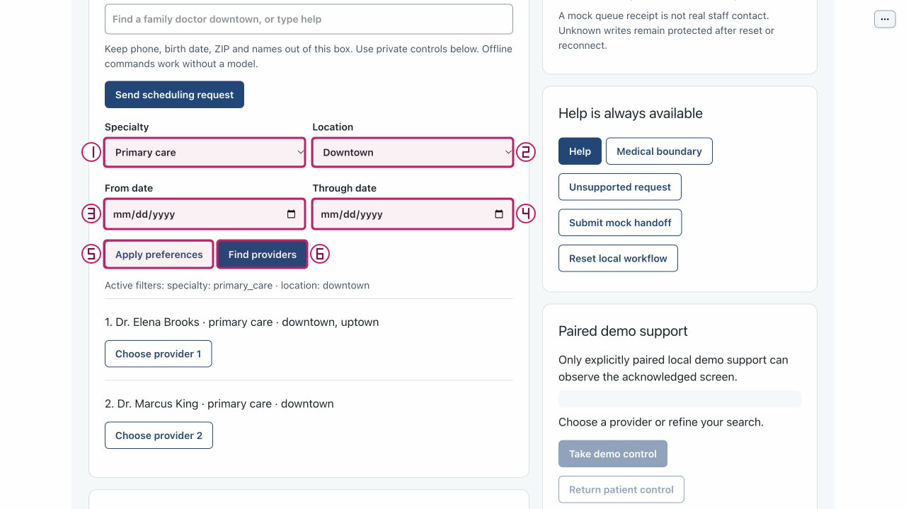

# Handle a taken slot and review a fresh choice

Purpose: Distinguish a definite 409 rejection from an unknown booking and recover with fresh consent. Role: patient reviewer.
Scope: slot_conflict / US1 / FR-008–FR-010. Mode: normal model-first launch with an explicit offline
control path; the documented local controls need no model call.
Limits: synthetic fixtures only; no production authentication, real staff contact
or clinical care. The conflict is a supplied slot fixture, not a fault toggle; previous confirmation never carries to another slot.

## Step 0 — Install and set up

From the repository root in your dedicated local checkout:

```sh
python3.11 --version
python3.11 -m venv .venv
.venv/bin/python -m pip install -e .
.venv/bin/python -m pip check
.venv/bin/python tools/poc-runtime/launch.py --doctor
```

Verify Python 3.11+ before creating the environment. If `python3.11` is absent,
use `python3.12 --version` and `python3.12 -m venv .venv` after verifying that
explicit executable is compatible; the remaining commands stay the same.
The doctor reads no key, starts no service and makes no model request. Use
[getting started](../getting-started.md) for the trusted exact-note helper and
current application runtime policy; do not paste a key into BOB or these notes.
Resolve a failed install, dependency check or doctor before proceeding.

## Step 1 — Launch

Normal model-first launch:

```sh
.venv/bin/python tools/poc-runtime/launch.py
```

Open the printed local URL. Startup/readiness is not model qualification.
For an explicit no-call walkthrough alternative, use the following ONLY IF both
ports are free:

```sh
.venv/bin/python tools/poc-runtime/launch.py --offline --ui-port 29580 --transport-port 29581
```

A port conflict is not permission to stop another process. Do not reuse an
existing process for this trial; arrange another free pair or defer launch.
Ctrl-C in your launch terminal stops only this launch's owned children. All
supplied W2 capture evidence is offline or explicitly historical, with no new
genuine model qualification.

## Arrange the workspace

Keep this rendered Markdown on the left and BOB on the right. In Chrome, open
the tab context menu and choose **New split view**, then **Add tab** for the
other page; use **Swap sides** if needed. Follow the
[official Chrome Split View instructions](https://support.google.com/chrome/answer/16971124?hl=en).
If unavailable, arrange two windows side by side; no extension or experimental
flags are required. Open figures full size if labels are small; each action
below also has a text equivalent.

## Synthetic sample data

1. Private Synthetic phone: `555-0101`.
2. Private Date of birth: `1985-04-12`.
3. Private ZIP discriminator: `70112`.
4. Public Specialty: Primary care (`primary_care`); Location: Downtown (`downtown`); dates blank.
5. Conflict choice: currently returned Primary care / Downtown row at `08:30:00-05:00`, materialized eight days from the mock's current date (`slot_conflict_001` in source only).
6. Fresh recovery choice: returned Downtown row at `09:00:00-05:00` for the first provider; review its actual calendar date.

Identity values belong only in private controls. Keep names, phone, DOB and ZIP
out of Public scheduling request; its examples below contain public intent only.

## Step 2 — Start a dedicated patient session
<!-- walkthrough-step: {"number":2,"interactive":true,"visual_ids":["toolbar-composite"],"control_ids":["start-independent-patient"]} -->

Select **Start independent patient** (`start-independent-patient`) in the toolbar of your own trial tab. Expected: a patient role and current revision, with no identity or proposal. Recovery: if creation or connection fails, resolve the launcher/connection message before entering data. Starting another session does not reconcile an earlier unknown write; do not use it to retry that write.


Actual offline screenshot with a separate numbered annotation, source `bdc4585`. Locator only: the pictured state is not proof that this step was newly executed.

## Step 3 — Find current public providers
<!-- walkthrough-step: {"number":3,"interactive":true,"visual_ids":["public-filters-composite"],"control_ids":["specialty","location","from-date","through-date","find-providers"]} -->

Choose (1) **Primary care** in Specialty (`specialty`) and (2) **Downtown** in Location (`location`); leave From date and Through date blank. Select **Find providers** (`find-providers`). Expected: the two returned public providers and matching Active filters, without private lookup or booking. Recovery: if no providers or an API error appears, review filters or use Help; do not fabricate a provider.



Actual offline screenshot with a separate numbered annotation, source `bdc4585`. Locator only: the pictured state is not proof that this step was newly executed.

## Step 4 — Check the private synthetic identity
<!-- walkthrough-step: {"number":4,"interactive":true,"visual_ids":["private-entry-composite"],"control_ids":["private-disclosure","synthetic-phone","date-of-birth","zip-discriminator","check-identity"]} -->

Expand **2 · Private synthetic identity** (`private-disclosure`). Enter (1) **Synthetic phone** `555-0101` (`synthetic-phone`), (2) **Date of birth** `1985-04-12` (`date-of-birth`), and (3) **ZIP discriminator** `70112` (`zip-discriminator`). Select **Check or correct identity** (`check-identity`). Expected: Identity: verified and cleared browser input boxes; fixture matching is not production authentication. Blank boxes on later submissions preserve the service’s local draft, not new consent. Recovery: if missing or ambiguous, correct only the private controls and check again; do not request private results until verified.


Actual offline screenshot with a separate numbered annotation, source `bdc4585`. Locator only: the pictured state is not proof that this step was newly executed.

## Step 5 — Select the returned conflict fixture
<!-- walkthrough-step: {"number":5,"interactive":true,"visual_ids":["returned-options-and-confirm-composite"],"control_ids":["get-availability","select-option"]} -->

Select **Get current availability** (`get-availability`). Among the returned rows, choose the **Select option** button (`select-option`) for Downtown at `08:30:00-05:00`, eight days from the mock's current date. Do not set a provider filter that excludes it. Review card 4's exact time/provider/location. Expected: an unbooked proposal. Recovery: if that row is not returned, stop this scenario; do not type a hidden slot ID or use an old screenshot as a choice.


Actual offline screenshot with a separate numbered annotation, source `bdc4585`. Locator only: the pictured state is not proof that this step was newly executed.

## Step 6 — Confirm and recognize a definite rejection
<!-- walkthrough-step: {"number":6,"interactive":true,"visual_ids":["returned-options-and-confirm-composite"],"control_ids":["confirm-appointment"]} -->

Select **Confirm appointment** (`confirm-appointment`) once for that proposal. Expected: booking: rejected, the slot-taken message and no validated booking receipt for this attempt; the proposal and old options clear. Recovery: request fresh options; do not repeat the previous confirmation. If the result instead says unknown, stop rather than following conflict recovery.


Actual offline screenshot with a separate numbered annotation, source `bdc4585`. Locator only: the pictured state is not proof that this step was newly executed.

## Step 7 — Refresh and separately confirm a new proposal
<!-- walkthrough-step: {"number":7,"interactive":true,"visual_ids":["returned-options-and-confirm-composite"],"control_ids":["get-availability","select-option","confirm-appointment"]} -->

Select **Get current availability** (`get-availability`) again. Choose the returned Downtown `09:00:00-05:00` option using **Select option** (`select-option`), review its exact current summary, and separately select **Confirm appointment** (`confirm-appointment`) once. Expected: a new completed attempt while the prior rejection remains historical. Recovery: absent/taken fresh options mean refine or Help; an unknown result means no retry.


Actual offline screenshot with a separate numbered annotation, source `bdc4585`. Locator only: the pictured state is not proof that this step was newly executed.

## Completion and cleanup

Effect: One rejected mock booking attempt, then one separately reviewed fresh mock booking attempt; only a validated receipt establishes completion. No real staff or care is provided. An unknown write may have
succeeded: do not retry it, even after reset, reconnect or a new session.

Cleanup: stop only your own launch with Ctrl-C in its terminal. Do not stop another
listener, purge recordings, erase Operator state or reset accounting/effect history.
Leave any existing receipt/history and uncertainty protection intact.

## Known gaps and evidence

Recovery: A definite 409 can permit fresh selection and consent. A lost or unverifiable receipt is unknown and blocks retry. Prior completed receipts must remain distinct from the current rejection.

From the repository root, the exact automated contract command is:

```sh
PYTHONPATH=src:tests .venv/bin/python -m unittest -v test_supplied_http.SuppliedHttpScenarioTests.test_slot_conflict test_transition_acceptance.TransitionAcceptanceTests.test_success_then_conflict_preserves_prior_receipt_and_current_rejection
```

These are existing test contracts, not a report of a run by this document worker.

Source basis: widget/service/core and test sources consulted at checker candidate
`66da0c8`; W2 actual offline atlas captures bind `bdc4585`. Later changes here
are documentation only and do not extend runtime evidence. The options atlas shows a proposal, not a captured 409. Exact fixture behavior comes from the supplied slots and real HTTP test; the transition method protects an earlier success during a later rejection.

The atlas supplies actual app observations for its labeled state only. Its
acknowledgement/kernel/reconnect warnings remain gaps; synchronized screens are
not established by a visible role. This entire journey remains unverified on this
document revision. This worker did not launch BOB, run a browser, invoke a model,
capture new visuals, run the listed tests or repeat the parent’s combined suite.
Structural coverage is not browser certification. Parent final QA/integration is pending.

## Revision history

- 2026-10-14: Drafted from exact native, test, widget/service and source-bound atlas
  sources; parent final QA/integration pending.

## References

- [Native specification](../../../specs/001-ochsner-scheduling-assistant/spec.md)
- [Native plan](../../../specs/001-ochsner-scheduling-assistant/plan.md)
- [Native progress and existing evidence](../../../specs/001-ochsner-scheduling-assistant/tasks.md)
- [Public discovery atlas](../controls/session-and-public.md)
- [Private identity and booking atlas](../controls/private-and-booking.md)
- [Help and outcomes atlas](../controls/help-and-outcomes.md)
- [Visual provenance manifest](../../../assets/ui/walkthroughs/manifest.json)
- [Widget controls](../../../src/ochsner_bob/widget.js)
- [Scheduling authority](../../../src/ochsner_bob/session.py)
- [Browser service](../../../src/ochsner_bob/browser_service.py)
- [Exact tests/test_supplied_http.py](../../../tests/test_supplied_http.py)
- [Exact tests/test_transition_acceptance.py](../../../tests/test_transition_acceptance.py)
- [Exact vendor/reference/data/slots.json](../../../vendor/reference/data/slots.json)
- [Exact vendor/reference/mock-api/server.py](../../../vendor/reference/mock-api/server.py)
