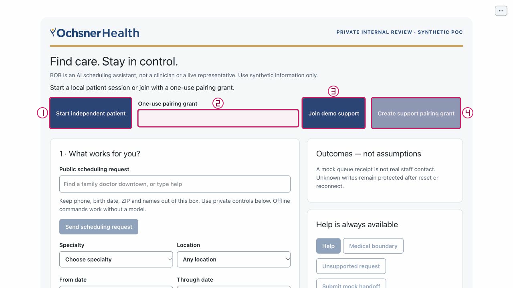
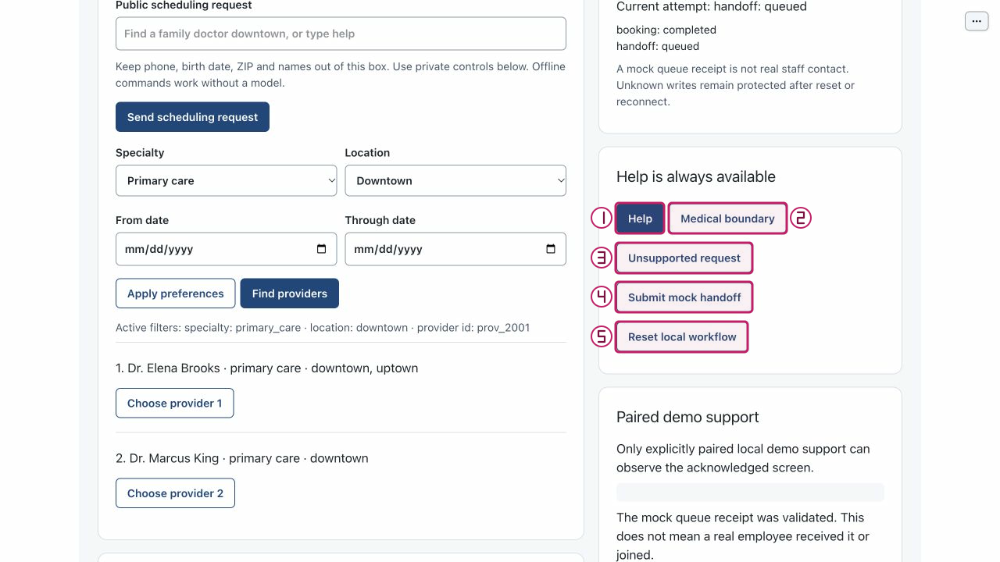

# Submit one deliberately requested mock handoff

Purpose: Distinguish a validated mock queue receipt from help preparation and actual staff contact. Role: patient reviewer.
Scope: US3 / FR-012. Mode: normal model-first launch with an explicit offline
control path; the documented local controls need no model call.
Limits: synthetic fixtures only; no production authentication, real staff contact
or clinical care. The button uses user_requested regardless of the prior Help/Medical/Unsupported wording.

## Step 0 — Install and set up

From the repository root in your dedicated local checkout:

```sh
python3.11 --version
python3.11 -m venv .venv
.venv/bin/python -m pip install -e .
.venv/bin/python -m pip check
.venv/bin/python tools/poc-runtime/launch.py --doctor
```

Verify Python 3.11+ before creating the environment. If `python3.11` is absent,
use `python3.12 --version` and `python3.12 -m venv .venv` after verifying that
explicit executable is compatible; the remaining commands stay the same.
The doctor reads no key, starts no service and makes no model request. Use
[getting started](../getting-started.md) for the trusted exact-note helper and
current application runtime policy; do not paste a key into BOB or these notes.
Resolve a failed install, dependency check or doctor before proceeding.

## Step 1 — Launch

Normal model-first launch:

```sh
.venv/bin/python tools/poc-runtime/launch.py
```

Open the printed local URL. Startup/readiness is not model qualification.
For an explicit no-call walkthrough alternative, use the following ONLY IF both
ports are free:

```sh
.venv/bin/python tools/poc-runtime/launch.py --offline --ui-port 29580 --transport-port 29581
```

A port conflict is not permission to stop another process. Do not reuse an
existing process for this trial; arrange another free pair or defer launch.
Ctrl-C in your launch terminal stops only this launch's owned children. All
supplied W2 capture evidence is offline or explicitly historical, with no new
genuine model qualification.

## Arrange the workspace

Keep this rendered Markdown on the left and BOB on the right. In Chrome, open
the tab context menu and choose **New split view**, then **Add tab** for the
other page; use **Swap sides** if needed. Follow the
[official Chrome Split View instructions](https://support.google.com/chrome/answer/16971124?hl=en).
If unavailable, arrange two windows side by side; no extension or experimental
flags are required. Open figures full size if labels are small; each action
below also has a text equivalent.

## Synthetic sample data

1. Initial control: Help.
2. Separate write control: Submit mock handoff; fixed reason `user_requested`.
3. No identity, raw narrative or email is required.

Identity values belong only in private controls. Keep names, phone, DOB and ZIP
out of Public scheduling request; its examples below contain public intent only.

## Step 2 — Start a dedicated patient session
<!-- walkthrough-step: {"number":2,"interactive":true,"visual_ids":["toolbar-composite"],"control_ids":["start-independent-patient"]} -->

Select **Start independent patient** (`start-independent-patient`) in the toolbar of your own trial tab. Expected: a patient role and current revision, with no identity or proposal. Recovery: if creation or connection fails, resolve the launcher/connection message before entering data. Starting another session does not reconcile an earlier unknown write; do not use it to retry that write.



Actual offline screenshot with a separate numbered annotation, source `bdc4585`. Locator only: the pictured state is not proof that this step was newly executed.

## Step 3 — Prepare assistance without submitting
<!-- walkthrough-step: {"number":3,"interactive":true,"visual_ids":["help-actions-composite"],"control_ids":["help"]} -->

Select **Help** (`help`). Expected: plain scheduling assistance, no new queued receipt. Recovery: read any existing Current attempt/history first so an earlier handoff is not mistaken for a new one.



Actual offline screenshot with a separate numbered annotation, source `bdc4585`. Locator only: the pictured state is not proof that this step was newly executed.

## Step 4 — Submit the separate mock queue request
<!-- walkthrough-step: {"number":4,"interactive":true,"visual_ids":["help-actions-composite"],"control_ids":["submit-handoff"]} -->

Select **Submit mock handoff** (`submit-handoff`) once. Expected: Current attempt handoff: queued after the mock queue receipt is validated, and a separate historical handoff entry. The summary is categorical/minimized, not a raw transcript or private identity. Recovery: failed/rejected is not queued; unknown means stop and do not repeat the write. Help alone never proves delivery.


Actual offline screenshot with a separate numbered annotation, source `bdc4585`. Locator only: the pictured state is not proof that this step was newly executed.

## Completion and cleanup

Effect: One minimized mock handoff POST with reason user_requested; no booking and no real employee joining. No real staff or care is provided. An unknown write may have
succeeded: do not retry it, even after reset, reconnect or a new session.

Cleanup: stop only your own launch with Ctrl-C in its terminal. Do not stop another
listener, purge recordings, erase Operator state or reset accounting/effect history.
Leave any existing receipt/history and uncertainty protection intact.

## Known gaps and evidence

Recovery: Keep API queue certainty separate from local Support participation. A queued receipt does not authorize Support takeover or guarantee contact. Never retry an unknown handoff.

From the repository root, the exact automated contract command is:

```sh
PYTHONPATH=src:tests .venv/bin/python -m unittest -v test_transition_acceptance.TransitionAcceptanceTests.test_all_reachable_state_safety_and_public_interruptions_are_effect_free test_supplied_http.SuppliedHttpScenarioTests.test_api_failure
```

These are existing test contracts, not a report of a run by this document worker.

Source basis: widget/service/core and test sources consulted at checker candidate
`66da0c8`; W2 actual offline atlas captures bind `bdc4585`. Later changes here
are documentation only and do not extend runtime evidence. The transition test builds a user_requested queued state and verifies interruptions preserve history; api_failure checks definite failed handoff without a receipt. W2 help-actions actually shows a current queued handoff alongside an earlier completed booking, not employee contact.

The atlas supplies actual app observations for its labeled state only. Its
acknowledgement/kernel/reconnect warnings remain gaps; synchronized screens are
not established by a visible role. This entire journey remains unverified on this
document revision. This worker did not launch BOB, run a browser, invoke a model,
capture new visuals, run the listed tests or repeat the parent’s combined suite.
Structural coverage is not browser certification. Parent final QA/integration is pending.

## Revision history

- 2026-10-14: Drafted from exact native, test, widget/service and source-bound atlas
  sources; parent final QA/integration pending.

## References

- [Native specification](../../../specs/001-ochsner-scheduling-assistant/spec.md)
- [Native plan](../../../specs/001-ochsner-scheduling-assistant/plan.md)
- [Native progress and existing evidence](../../../specs/001-ochsner-scheduling-assistant/tasks.md)
- [Public discovery atlas](../controls/session-and-public.md)
- [Private identity and booking atlas](../controls/private-and-booking.md)
- [Help and outcomes atlas](../controls/help-and-outcomes.md)
- [Visual provenance manifest](../../../assets/ui/walkthroughs/manifest.json)
- [Widget controls](../../../src/ochsner_bob/widget.js)
- [Scheduling authority](../../../src/ochsner_bob/session.py)
- [Browser service](../../../src/ochsner_bob/browser_service.py)
- [Exact tests/test_transition_acceptance.py](../../../tests/test_transition_acceptance.py)
- [Exact tests/test_supplied_http.py](../../../tests/test_supplied_http.py)
