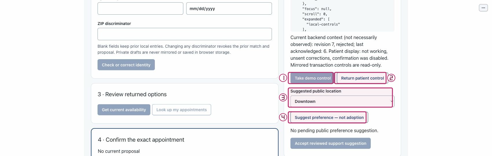
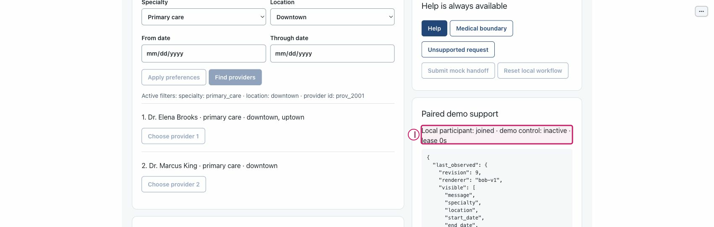

# Take and return local demo control

Purpose: Distinguish temporary control from continuing paired membership. Role: patient and local demo Support reviewer.

Scope: US5. Mode: offline control exercise; normal launch is model-first. Limits: synthetic local PoC only; no production authentication, live representative or clinical service. The full journey remains unverified on this documentation candidate.

## Step 0 — Install and set up

From the repository root, verify Python 3.11+ and install into the project environment:

```sh
python3.11 --version
python3.11 -m venv .venv
.venv/bin/python -m pip install -e .
.venv/bin/python -m pip check
.venv/bin/python tools/poc-runtime/launch.py --doctor
```

If `python3.11` is absent, use an explicit compatible executable, for example `/opt/homebrew/bin/python3.12`: verify its `--version` is 3.11+ and use that same executable for `-m venv .venv`. Do not assume `python3` is compatible. Follow [getting started](../getting-started.md) for the trusted exact-note helper and current application runtime policy. Doctor retrieves no key, starts no service and makes no model call.

## Step 1 — Launch

Normal model-first launch:

```sh
.venv/bin/python tools/poc-runtime/launch.py
```

Open the printed local URL. Startup/readiness does not qualify model behavior. A port conflict is an error, not permission to stop another process. Ctrl-C owns only this launch and its children.

For an explicit no-call walkthrough, use the following only if **both ports are free**:

```sh
.venv/bin/python tools/poc-runtime/launch.py --offline --ui-port 29580 --transport-port 29581
```

Do not reuse or stop an existing process on those ports. All supplied W2 capture evidence is offline or dated historical synthetic evidence; it is not genuine new model qualification.

## Arrange the workspace

Keep this rendered Markdown on the left and BOB on the right. In Chrome, open a tab's context menu and use **New split view**, then **Add tab** to select the other tab; use **Swap sides** if needed. See [official Chrome Split View guidance](https://support.google.com/chrome/answer/16971124?hl=en). If unavailable, use side-by-side windows; no extension or experimental flags are needed.

## Synthetic sample data

1. Use a current one-use patient grant in a second local tab.
2. Freshness prerequisite: current revision and acknowledgement age under five seconds; lease maximum 300 seconds.
3. Private synthetic phone: `555-0101` in **Synthetic phone** only.
4. Private DOB: `1985-04-12` in **Date of birth** only.
5. Private ZIP: `70112` in **ZIP discriminator** only. These values are optional orientation for flows that do not identify a patient.

Keep names, phone, DOB and ZIP out of the public request box. Only application-owned private identity controls receive those fixture values. Use only your own disposable local session and recording references.

## Step 2 — Start the patient and open the local support workspace
<!-- walkthrough-step: {"number":2,"interactive":true,"visual_ids":["toolbar-composite"],"control_ids":["start-independent-patient"]} -->

Select **Start independent patient** (`start-independent-patient`) in a tab opened at the printed URL. Keep this patient tab open; open the same URL in a separate tab for Support. Expected: a new patient session, not reconnection to an old patient's effects. Recovery: if no patient state appears, check the launch connection and refresh; do not reset or reuse another person's session.


The figure is an existing atlas locator with separate numbered annotations over actual pixels; the action and expected result above are its text equivalent. It is not a newly executed result or a captured failure.

## Step 3 — Create and consume a one-use pairing grant
<!-- walkthrough-step: {"number":3,"interactive":true,"visual_ids":["toolbar-composite"],"control_ids":["create-pairing","pairing-grant","join-support"]} -->

In the patient tab select **Create support pairing grant** (`create-pairing`). Transfer the displayed value privately into **One-use pairing grant** (`pairing-grant`) in the second tab and select **Join demo support** (`join-support`) once. Do not put grants in Markdown, public requests, screenshots or logs. Expected: the second tab changes to Support for this patient; joining does not take control. Recovery: an invalid, consumed or expired grant requires a new grant from the same current patient, not repeated use of the old value.


The figure is an existing atlas locator with separate numbered annotations over actual pixels; the action and expected result above are its text equivalent. It is not a newly executed result or a captured failure.

## Step 4 — Take a fresh temporary demo lease
<!-- walkthrough-step: {"number":4,"interactive":true,"visual_ids":["support-actions-composite","support-active-state-composite"],"control_ids":["take-control"]} -->

Only when the paired screen reports a current acknowledgement less than five seconds old, select **Take demo control** (`take-control`) in Support. Expected: membership stays joined while control becomes active with a lease of up to 300 seconds; patient transaction controls become unavailable. No private identity or confirmation authority transfers. Recovery: if the button is disabled, the request is stale or acknowledgement is unavailable, refresh/review the patient view and recheck freshness; do not force the event. Historical `c3e6df2` locates the button; repaired `e2dfa7e` locates the active lease label.




The figure is an existing atlas locator with separate numbered annotations over actual pixels; the action and expected result above are its text equivalent. It is not a newly executed result or a captured failure.

## Step 5 — Return patient control and retain pairing
<!-- walkthrough-step: {"number":5,"interactive":true,"visual_ids":["support-actions-composite","support-returned-state-composite"],"control_ids":["return-control"]} -->

Select **Return patient control** (`return-control`) in Support. Expected: joined membership remains, control is inactive and lease is immediately zero. A returned lease does not restore an old proposal or old confirmation. Recovery: refresh both views and inspect actual revision/lease after a stale result; do not assume the return succeeded from a click alone. Historical composites locate the action and repaired returned state.




The figure is an existing atlas locator with separate numbered annotations over actual pixels; the action and expected result above are its text equivalent. It is not a newly executed result or a captured failure.

## Completion and cleanup

Effect: Local pairing, lease and public preference state only. No booking, mock handoff, real staff contact or care is performed. Replay and comparison confer no live consent or authority. If any earlier live write has unknown outcome, do not retry it; reconcile separately.

Cleanup: Close only your own demonstration tabs. If replay is playing, select Pause before leaving. Stop only your own launch with Ctrl-C; never stop an existing Operator process, purge an Operator recording, or erase capability, accounting or effect state.

## Known gaps and evidence

Recovery: Takeover/return figures are historical `c3e6df2`/`e2dfa7e`. The former predates the membership-label repair; use the latter for membership/lease state. No new takeover or synchronization was observed at W2. If reconnect clears diagnostics or resets the replay index, inspect current state, reopen your owned reference if available and re-enter a valid bounded index. A queued action or click is not proof that the intended transition happened.

Source basis: application/atlas source `bdc4585` and parent checker checkpoint `66da0c8`, with later docs-only changes. Support originals retain `c3e6df2` / `e2dfa7e` where used: their unchanged control constructors are applicable, but the older membership label is not evidence of repaired status. Current IAB joined/inactive and acknowledgement-unavailable observations are not fresh successful synchronization.

The W2 atlas supplies historical/offline actual control observations only; this document adds no browser execution evidence. Test methods below describe existing automated contracts, not newly run tests:

```sh
PYTHONPATH=src:tests .venv/bin/python -m unittest test_support_status.SupportStatusTests.test_takeover_reports_active_control_separately_from_pairing -v
PYTHONPATH=src:tests .venv/bin/python -m unittest test_support_status.SupportStatusTests.test_return_keeps_pairing_and_zeroes_unelapsed_lease -v
```

Not run by this document worker: setup/install/doctor, app launch, browser actions, fault injection, model calls, destructive purge, demos or the full suite. Parent owns combined verification and final integration. Structural coverage is not browser certification; no mobile, accessibility, renderer-parity or genuine new model qualification is claimed.

## Revision history

- 2026-10-14: Drafted from exact sources and supplied atlas evidence; parent final QA/integration pending. Native tasks remain the sole progress ledger.

## References

- [Native specification](../../../specs/001-ochsner-scheduling-assistant/spec.md) · [plan](../../../specs/001-ochsner-scheduling-assistant/plan.md) · [native tasks](../../../specs/001-ochsner-scheduling-assistant/tasks.md).
- [Control atlas](../controls/support.md) · [all control groups](../controls/index.md).
- [Visual manifest and evidence limitations](../../../assets/ui/walkthroughs/manifest.json) · [historical still provenance](../../../assets/ui/stills/feature-completion-20261010/manifest.json).
- [Runtime and exact-note helper guidance](../getting-started.md) · [recovery](../recovery.md).
- [tests/test_support_status.py](../../../tests/test_support_status.py).
- [src/ochsner_bob/browser_service.py](../../../src/ochsner_bob/browser_service.py).
- [src/ochsner_bob/widget.js](../../../src/ochsner_bob/widget.js).
